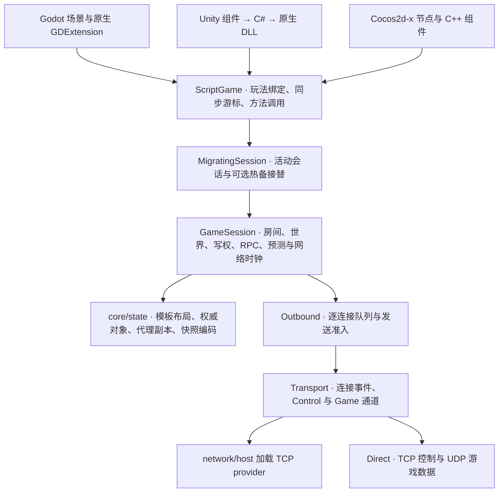
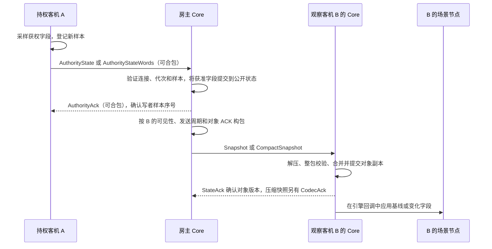

# Netcode 运行时架构

**框架支持多个引擎，单局只支持同引擎联机。** Godot、Unity、Cocos2d-x 各有一个平台 SDK。房主与客人运行同一游戏，使用兼容的对象模板、字段和 RPC 定义。三个 SDK 复用 C++17 Core 的会话与复制逻辑，各自在本地访问节点、脚本和物理世界。本文依据 2026-11-26 两个仓库的工作区源码，SDK 制品的实测范围按构建标识另列。[同引擎同步契约](specs/game-session.md#同引擎客户端同步) · [SDK 验收记录](sdk-validation.md)

## 系统分层



| 代码位置 | 职责与边界 |
|---|---|
| [core/state](../core/state) | 将类型化字段映射到定长状态，按接收者选取增量，处理基线、依赖、隐藏与销毁。固定步预测和快照插值也有可复用的数据结构。 |
| [core/session](../core/session) | 以房间、局次、玩家和网络对象标识关联消息，协调成员、创建、授权、分发与确认。游戏通过 `ScriptGame` 接入，也可直接组合底层模块。 |
| [core/transport](../core/transport) 与 [network](../network) | Core 依赖 `Transport` 接口。provider 宿主负责加载模块，TCP 与 Direct 提供实际连接，测试可用内存链路。 |
| [engineplatform](../engineplatform) | 把引擎属性和方法绑定到模板，把本地生命周期接入会话。Core 的对象记录只保存网络身份与状态。 |
| [examples](../../examples/README.md) | 游戏负责场景资产、玩法规则、输入和渲染。`sync-lab` 走 Godot 原生节点与 TCP。车场用自己的 `Runner` 和 `Match` 组合 Core，其驾驶规则、Direct 时钟及重连剧本只适用于车场。 |

## 房间、对象与写权

一个玩家房主保存房间公开状态，负责准入、分配网络身份、裁决写权，以及向每个客人分发其可见状态。对象的业务归属 `owner` 和当前状态写者 `writer` 可以不同。写权随对象授予，交接时推进 `epoch`。房主从实际连接取得提交者身份，再核对写者、代次、样本顺序和允许写入的字段。客机持权时，更新先到房主，再从房主分发给观察者。[对象写权契约](specs/object-authority.md) · [授权与提交实现](../core/session/object_authority.cpp)

通用会话可通过局域网目录发布和搜索房间，玩法也可直接连接指定端点。房间可包含多个局次。游戏消息携带房间号和局次号。场景对象按对象号关联模板、模板版本和字段布局签名，本地节点句柄由各适配器管理。`GameGlobal` 由协调玩家写入，带作者键的实例按 `(scene, key)` 区分；无键实例只能位于默认场景，并独占同模板的全局实例名额。[局域网发现](../core/session/discovery.hpp) · [世界与对象登记](../core/session/world.cpp)

Godot 原生房间在建房和加入时登记生成模板目录，并校验原生房间协议（当前 v5）与目录指纹。Core 的 word 差量、上行合包和快照压缩各有独立的逐连接协商条件。Shared 动态生成可以先返回本地实例，正式网络身份和可提交写权以绑定完成为准。观察端以首个基线初始化对象，再触发生成信号。随后的隐藏、重入和销毁分别处理。[房间与生成契约](specs/godot-scene-sync.md#原生节点接入)

## 对象状态的内存布局

一个模板计算一次字段偏移和签名。每个对象按模板使用若干个 32 位 word。标量、向量分量和有界字符串或集合占用不同数量的槽位。类型化值供玩法和引擎访问，word 供比较、合并与编码。当前值、Shadow 和变化版本各用一个连续数组。以下是各数据结构持有的缓冲与索引。[字段类型与布局](specs/property-binding.md#状态布局和差量) · [类型与打包实现](../core/state/value.cpp) · [权威状态与副本定义](../core/state/replication.hpp)

```text
模板 Schema
  fields[] + layout.offsets[]          字段 i 占 [offsets[i], offsets[i+1])
  wire_fingerprint                    接收时核对线格式

房主 AuthorityState，每个对象一份 Entry
  Object                              id、schema、owner、sample_tick、revision、类型化 values
  WordState
    words[]                           当前采样，每项 32 位
    shadow[]                          上次发送扫描时的 word
    revisions[]                       每个 word 最后变化时的对象版本
    pending_scan                      本轮是否需要比对 words 与 shadow

房主每条连接一份 Progress，以对象号索引
  baseline / sent / ack               基线、已发版本与发送步、已确认版本与就绪状态
  hidden / reentered / pending_exits  可见性切换与待确认的退出记录

客机 ReplicaState
  objects_ / words_                   已提交的对象、类型化值与对应的 word 基线
  staged_values_ / staged_words_      验证当前快照时复用的暂存区

客机持写权时，ObjectAuthority 另存
  writable_words_ / ObjectGrant       可写字段的 WordState、授权代次、样本序号与确认进度
```

`capture_sample` 先比较新采样和当前 `words`。值有变化才推进对象版本并标记待扫描。发送阶段 `scan` 比较 `words` 和 `shadow`，刷新变化位置及其版本。随后每个客人依据自己的对象 ACK 选取尚未确认的 word。因此同一对象只保留一份发送扫描用的 Shadow，两个客人仍可收到不同的增量。客机持权上行也执行这次扫描，比较基准换成房主已确认的**写者样本序号**。[采样、扫描与候选选择](../core/state/replication.cpp) · [上行编码](../core/session/object_authority.cpp)

例如，sync-lab 小球的 8 个属性按其模板容量占 37 个 word。权威侧的当前值、Shadow 和变化版本各占 148 B，三组数组元素合计 **444 B/球**。完整对象还要计入类型化值、容器、节点和逐连接进度。线上字节则取决于这次变化了几个 word、几个对象共用包头，以及是否压缩。[小球字段与字节明细](../task/godot-platform/验收/sync-lab单球同步开销.md#一个球的八个属性)

## 一次状态更新怎样收发

下图以持权客机 A 修改属性、客机 B 观察为例。房主自己持权时，由本地属性采样直接进入房主的 `AuthorityState`。房主接收 A 的提交后，可以从 Core 已提交的公开状态给 B 构包。房主场景节点的 setter 可以按引擎调度单独执行。[会话收发循环](../core/session/game_session.cpp) · [持权上行与合并](../core/session/object_authority.cpp) · [Godot 节点绑定](../engineplatform/godot/scene_binding.cpp)



| 方向 | 实际传输形式 |
|---|---|
| 客机写者 → 房主 | 逐连接协商 word 能力。按可写模型发送完整样本或稀疏 word。房主只更新获准字段，全部字段都授权时可复用已校验的 word。双方另行协商且 Game 通道可靠有序时，多条状态和对应回执可分别装入 `AuthorityStateBatch`、`AuthorityAckBatch`。 |
| 房主 → 观察者 | 首次可见、重入或需要重建基线时发送完整字段。稳态下比较逐 word 版本与该连接 ACK。已协商、无需量化且编码合算时发送变化 word 的相对位置和值，其他情况使用字段掩码和值。稀疏 word 记录写入数量、相邻变化位置的跳数和新值。每个快照可以包含多条对象记录。 |
| 观察者 → 房主 | `StateAck` 表示 Core 已处理对象版本。协商压缩后，`CodecAck` 确认可供后续快照引用的字节基线，缺失锚点时可返回 `CodecReset`。场景显示完成时间要在引擎侧测量。 |

游戏头含消息类型、房间号和局次号。TCP provider 在外层再加 1 字节通道和 2 字节负载长度，一条 TCP 连接承载 Control 和 Game。Core 的 `Outbound` 按连接保留尚未被传输接纳的消息，阻塞时暂缓为该连接生成新快照，恢复后按最新状态和 ACK 重新选择。provider 可将多帧合到一次套接字写入，接收端仍按帧边界交付。Direct 车场使用 TCP 控制、UDP 游戏数据，按其通道能力走对应的重发和协商路径。[消息定义](../core/session/game_wire.hpp) · [逐连接发送队列](../core/session/outbound.cpp) · [TCP 帧编解码](../network/tcp/provider.cpp) · [快照压缩](../core/state/snapshot_codec.cpp)

## 帧调度与引擎绑定

**Godot 有两个推进时点。** 原生房间的 `NetcodeClientProcessor` 在空闲处理帧调用 `NetcodeSession::advance`，经 `NetcodeGame` 泵送 Core。普通房间先轮询并处理收到的消息，再执行 `flush`。快照按新的会话 tick 生成。原生房间默认步长 30 ms，目录注册了预测模型时为 16 ms。已绑定的 Replicator 在内部物理回调采样持权节点或更新代理节点。一个显示帧内可能有多个物理步，因此房间推进耗时、节点同步耗时和 FPS 需要分别观察。[原生房间调度](../engineplatform/godot/native_session.cpp) · [复制节点物理回调](../engineplatform/godot/native_nodes.cpp) · [会话时钟](../core/session/game_session.hpp)

| 平台 | 游戏如何接入 | 属性如何进出 Core |
|---|---|---|
| Godot | `Netcode` 单例开房或加入。把 `NetcodeSharedReplicator` 或 `NetcodeServerReplicator` 挂在场景对象上，用 `NetcodeReplicationConfig` 选字段，用 `NetcodeSpawner` 注册与实例化 `.tscn`。 | C++ 绑定读取本地属性。仅含普通根字段的 Shared 对象可启用 `apply_proxy_changes_only`。在已绑定、按每步同步的快路径中，一次 Core 查询即可取得角色及变化字段。稳定代理跳过 setter，首次绑定、重新取得基线或写权代次变化时完整应用。预测、刚体、插值按各自绑定处理。[小球场景](../../examples/sync-lab/netcode_global.tscn) · [属性配置](../../examples/sync-lab/netcode_orb_config.tres) |
| Unity | 玩法在主线程推进 `NetcodeGame.Advance()`。新游戏可用 `OpenWithProvider` 打开 TCP。C# 经 C ABI 调用平台 SDK 的 `netcode_unity.dll`。 | `NetcodeReplica.FixedUpdate` 从已绑定的成员或刚体取样，经 `SyncReplica` 同步并应用返回值。车场有独立的 `netcode_yard_unity.dll`。[通用 C# 入口](../engineplatform/unity/managed/NetcodeGame.cs) · [复制组件](../engineplatform/unity/managed/NetcodeReplica.cs) · [车场桥接](../../examples/yard/unity-native/CMakeLists.txt) |
| Cocos2d-x | 游戏将 `GameComponent` 挂在节点上，可用 `create_with_provider` 打开 TCP。 | `ReplicaComponent` 绑定对象号和字段读写器，或接入刚体。会话和节点更新在引擎线程推进。[会话组件](../engineplatform/cocos2dx/game_component.hpp) · [复制组件](../engineplatform/cocos2dx/replica_component.hpp) |

## 可见性、频率与对象生命周期

房主按连接筛选对象。地图加载就绪、显式对象集合、父对象和依赖、区域或用户兴趣键共同决定可见性。稀疏兴趣下，构包只遍历该连接的基线集合与待退出记录。密集兴趣下顺序遍历对象表。离开兴趣区发送隐藏记录，重新进入后发送最新基线。对象真正销毁时，房主保留待确认记录，防止迟到的旧快照复活实例。[可见性与构包](../core/state/replication.cpp) · [兴趣回归](../tests/core/interest_test.cpp)

可见对象还可降频。Godot 用 `NetcodeInterestArea.send_divisor` 设置区域更新周期，低频差量按稳定对象号错开发送，首次进入、重入或需重建基线的对象优先处理。房间可选 `retain_spatial_writer_interest`，让持权客人跨出订阅格后继续接收该对象，仍受地图、显式选择和依赖约束。符合条件的房主本地写者可复用本次根字段采样中的坐标更新空间格。[空间兴趣契约](specs/godot-scene-sync.md#空间兴趣与输入预测) · [Godot 空间实现](../engineplatform/godot/native_simulation.cpp)

## RPC、预测与房间恢复

| 机制 | 运行时行为 |
|---|---|
| RPC | 玩法为方法登记作用域、方向、参数与可靠性，房主根据真实连接、业务归属或当前写权路由。经典可靠 RPC 按发送端、接收端及作用域维护顺序。Godot 原生 RPC 另有请求、投递、回执和结果。玩法需要在晚加入时仍然可见的结果应写入复制状态。[RPC 契约](specs/rpc.md) · [原生 RPC](../core/session/native_rpc.cpp) |
| 输入预测 | 选择预测模型时，由玩法注册输入、状态和单步模拟。客机先推进本地预测，收到权威恢复点后重演尚未确认的输入。Godot 的 `NetcodeServerReplicator` 走这条路径。普通 Shared 字段走状态复制。车场的车辆模型与刚体组回放有各自的时钟和恢复数据。[模型预测](../core/session/model_prediction.cpp) · [Godot 预测绑定](../engineplatform/godot/native_simulation.cpp) · [车场模型](specs/physics-prediction.md#已实现的房主预测) |
| 客人重连 | 通用会话可按配置保留席位，持有效票据的客人可恢复原身份，按当前可见基线重建对象。Godot 原生 `Netcode.create_room` 将席位保留时间设为零，断开后的玩家走普通加入流程。[房间规格](specs/game-session.md#同引擎客户端同步) · [原生房间入口](../engineplatform/godot/native_session.cpp) |
| 房主离开 | 通用会话可预先登记可信热备并传递检查点。三人及以上的故障接替需取得多数票。双人房支持在线房主主动交接。可恢复进度取决于热备已收到的检查点。Godot 原生房间入口仅提供创建、加入和离开。使用热备的玩法走支持接替的会话接口。[迁移条件](specs/game-session.md#玩家接替房主与本地找房) · [迁移实现](../core/session/migration.cpp) |

## 验证与复现

| 要核对的问题 | 验证入口 |
|---|---|
| Core 的线格式、差量、写权、兴趣、压缩与迁移 | 在框架仓运行 `python -B tools/build.py core` 构建并执行 Core CTest。[测试清单](../tests/core/CMakeLists.txt) |
| 三种引擎能否分别完成同引擎联机 | 构建对应示例后，在示例仓运行 `python -B tools/verify_gameplay_components.py --engine godot`、`--engine unity` 或 `--engine cocos`，每组各开两个本引擎进程。[引擎双端验收](../../examples/tools/verify_gameplay_components.py) |
| Godot 节点采样、写回和房间推进各耗时多少 | sync-lab 报告给出 1024 球、每球 8 属性的字节数及每物理步节点耗时。幸存者报告另有持权分布、AOI、合包和房间推进的分项。引用结果时同时注明项目、构建标识、运行模式和计时范围。[单球实测](../task/godot-platform/验收/sync-lab单球同步开销.md) · [幸存者累计对照](../task/godot-platform/验收/属性同步性能.md#随附-sdk-与第-30-版的原样聚怪对照) |

SDK 的安装、打包和示例仓布局见[接入说明](../README.md#独立构建与外部接入)。Photon 原版的客户端证据和产品差异见[联机全流程对照](fusion-session-comparison.md)与[逐 word 复制对照](fusion-core-comparison.md#逐-word-复制实现)。
