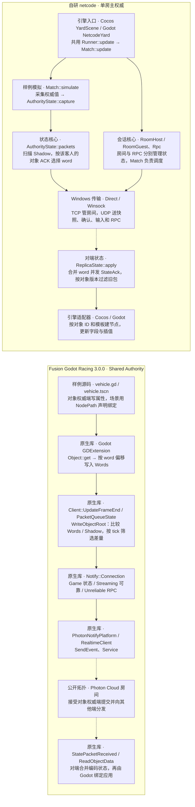

# 多引擎联机框架架构技术文档

**技术基线**　Windows x64 · C++17 · Cocos2d-x 4 · Godot 4.7.1\
**文档日期**　2026-11-20

项目把房间、玩家身份、属性复制和 RPC 放在同一套 C++ 核心中。Cocos2d-x 通过 C++ 适配器接入，Godot 通过 GDExtension 接入。两种实现共用车场逻辑及线上协议，已经验证两种引擎分别担任房主时均可联机。当前交付范围是 Windows x64 和已知 IPv4 地址直连。

## 1. 系统分层

```text
Cocos2d-x 窗口      Godot 窗口        轻量客人
    │                 │                │
 C++ 适配器      GDScript + 扩展       CLI
    └───────────┬─────┴────────────────┘
           yard_match
     布局解析 · 车场规则 · 调度
                │
           netcode_core
     RoomHost / RoomGuest · RPC
     AuthorityState / ReplicaState
                │ Transport
       MemoryTransport / netcode_direct
                          │
                Winsock TCP + UDP
```

| 层 | 负责的状态和职责 | 主要入口 |
| --- | --- | --- |
| 传输 | 连接句柄、监听和连接、投递类别、读写事件、断开和流量统计 | `core/transport/transport.hpp`、`direct_win.cpp` |
| 会话 | 房间阶段、成员、局次、身份恢复、RPC 权限和投递 | `core/session/room.hpp`、`rpc.hpp` |
| 状态 | schema、权威对象、客户端副本、差量编码、对象版本与确认 | `core/state/replication.hpp` |
| 样例业务 | 汽车控制、物理步进、碰撞、门和路障、运行与复测剧本 | `examples/car-yard/match.cpp`、`runner.cpp` |
| 引擎适配 | 节点创建与释放、属性写入、路径解析、显示插值、键盘及窗口 | `engineplatform/cocos2dx/`、`engineplatform/godot/`、`examples/godot-yard/` |

`netcode_core` 可以单独构建。传输接口 `Transport` 只交换事件、对端句柄和字节数组，调用方在进程循环中拉取事件。核心使用的类型中没有 Cocos 节点或 Godot 对象。Windows 直连和内存链路都实现同一接口，因此房间和复制可以各自通过可控链路单测，也能接真实套接字验证。[引擎分层决定](decisions/engine-boundary.md)

## 2. 运行拓扑和时钟

正常联机有一个权威房主和至多三个客人。房主同时可以驾驶自己的车。客人提交驾驶输入和操作请求，房主根据当前世界和玩家归属计算结果。车辆归属用于输入和对象 RPC 路由，场景对象最终状态仍由房主决定。

| 时钟 | 当前目标 | 负责的工作 |
| --- | --- | --- |
| 渲染循环 | 60 Hz | 处理本地输入、泵网络、从副本更新画面 |
| 房主模拟 | 30 Hz | 按固定时间步推进运动、加速度和碰撞，采集属性 |
| 网络发送 | 20 Hz | 房主打包状态，客人发送最新输入 |
| TCP 心跳 | 250 ms | 保持连接，默认以 3 秒作为失联判定阈值 |
| 可靠 RPC 重试 | 100 ms | 在对应流中重发未确认调用 |

`Runner` 调用 `Match::update`，先处理连接事件，再对房主模拟补步并在发送时点提交消息。房主从实际连接取得发送玩家，输入包含递增序号和两个归一化浮点值。房主接受新的有效输入，连续 8 个模拟步没有收到更新时把客人控制量降为零。`sample_tick` 标识对象采样时点，`send_tick` 是网络发送序号，客户端用本地渲染步推进显示插值。[运行时契约](decisions/first-edition-runtime.md)

## 3. TCP、UDP 和线上消息

连接端点默认为 `127.0.0.1:43210`，地址与端口可配置。房主在同一个 IPv4 端口监听 TCP 和接收 UDP。连接建立后，房主通过 TCP 发出每连接随机值，客人的 UDP 注册报文带上该值。房主将它与 TCP 来源 IPv4 和实际 UDP 端点关联。新连接分配新的对端句柄和随机值。协议游戏包还携带房间和局次，用于隔离离线或跨局的旧消息。

| 通道 | 编码及用途 | 交付约束 |
| --- | --- | --- |
| TCP 控制 | 小端长度帧。连接关联值和心跳，以及 `Join`、`Resume`、`Entered`、`Seats`、`RoundEnded`、`RoomEnded`、`Rejected` | 应用层控制负载上限 65,535 字节，发送队列有界 |
| UDP 游戏 | 20 字节的连接关联头，游戏负载再以类型、房间 ID、局次 ID 开头 | 总报文上限 1,196 字节，游戏负载上限 1,176 字节 |
| UDP 输入 | `Input`。序号、油门和转向 | 最新有效序号覆盖较旧输入 |
| UDP 状态 | `Snapshot`、`StateAck`、`Ready` | 逐连接、逐对象跟踪确认和恢复进度 |
| UDP 调用 | `Rpc`、`RpcAck` | 应用层按方法类型提供可靠有序或尽力投递 |

以上连接关联机制用于当前直连会话的路由和隔离。TCP 与 UDP 游戏协议以明文编码运行，部署使用可信网络环境。支持独立验证的故障注入层可丢弃、复制或延后指定序号的游戏包。[传输接口](../core/transport/transport.hpp) · [连接设计](decisions/game-transport.md)

## 4. 身份、房间与局次

| 标识 | 作用域和寿命 |
| --- | --- |
| `RoomId` | 房间身份，从开房直到房主关闭该房间 |
| `RoundId` | 同一房间可连续开局，每局独立编号 |
| `PlayerId` | 房间内稳定成员身份，房主默认 `1` |
| `Peer` | 一条当前连接的句柄，重连时更换 |
| `ObjectId` | 同一局内单调分配，持久对象由局次与对象 ID 共同定位 |
| `ResumeTicket` | 房间、局次、玩家和恢复凭证的组合 |

房间从等待进入进行中。等待时可以加入，开局后锁定成员。房主结束本局后返回等待，清理旧局状态和离线席位，可在同一房间再次开局。房主主动关闭或失联，客人结束房间。普通客人掉线时，原玩家席位和车辆保留到本局结束。恢复申请必须匹配当前局、成员及凭证，且该成员当时离线。[房间行为规格](specs/room-rejoin.md)

## 5. 声明式属性和复制算法

### 5.1 schema 与属性绑定

共用配置 `replicators.cfg` 定义模板 ID、定义版本、字段 ID、目标路径和属性。`transform2` 展开二维位置、角度和缩放。`transform3` 展开三维位置、欧拉角和缩放。`float`、`flag` 声明业务字段。字段 ID 严格递增，每个 schema 最多 64 字段。配置中 `.` 代表根节点，`lamp` 和 `model` 指向子节点。

| 对象 | 例子 |
| --- | --- |
| 车辆 | 模板 1。根节点 2D 变换与 `net_input_x`，子节点 `lamp` 的 `glow` |
| 闸门 | 模板 2。根变换与 `is_open` |
| 3D 展示物 | 模板 3。`model` 子节点的 3D 变换与根字段 `marker` |
| 路障及负载对象 | 模板 4、5。2D 变换和标记字段 |

布尔值在内存中占一个 word，在完整字段编码中占一个字节。活对象记录带 schema ID、版本和字段列表指纹。接收方按模板辨认字段掩码或 word 位置，校验后应用到副本。[共享配置](../examples/car-yard/replicators.cfg) · [属性行为规格](specs/property-binding.md)

### 5.2 采样、差量、确认

1. 房主调用 `AuthorityState::capture` 把采样值写入模板的定长 word 位置。位模式变化时增加对象 revision。发送扫描比较 `Words` 和 `Shadow`，给变化的 word 记录当前版本。
2. 每条连接记录已发送与已确认的对象版本。房主选择晚于该客人已确认版本的 word，按包大小分组。客人首次见到对象时收到完整字段，后续可收差量。最终状态在确认到达前持续可发送。
3. `ReplicaState::apply` 先解析完整报文，再提交对象变更。只提交比本地已知版本新的记录。旧包和重复包也可以再次被确认，由此避免确认丢失造成持续重发。
4. `StateAck` 返回对象和已处理版本的集合。房主在已发送进度范围内单调推进确认，不受迟到的较旧 ACK 影响。不同对象可以独立追赶。

因此，状态收敛允许中间字段值被新采样覆盖。一次性动作使用单独的 RPC 语义。验证覆盖最后一次变化丢失、重复包、旧包晚到和最终 ACK 丢失。[复制代码](../core/state/replication.cpp) · [核心复制回归](../tests/core/replication_test.cpp)

### 5.3 Shadow Buffer 与状态副本

`WordState` 将当前状态、上次发送扫描和变化版本保存在三个连续数组中。房主和持权客人用同一结构。引擎接口和检查点仍使用类型化值。[布局与收发图](specs/property-binding.md#状态布局和差量)

| 数据 | 作用 |
| --- | --- |
| `Words`、`Shadow`、逐 word 版本 | 保存当前采样、上次扫描结果和每个 word 最后一次变化的版本 |
| 房主每条连接的 `Progress::ack` | 为每个对象记录该客人已确认到的版本。选取变更版本高于 ACK 的 word 和其当前值 |
| 客人的 `ReplicaState` | 保存最近应用的权威 word 和类型化值。差量合并后将受影响字段解码供引擎使用 |
| 引擎适配器的显示值 | Cocos 的 `from/to/display` 和 Godot 的 `previous/target/displayed` 用于变换插值。显示值不会参与发送差量的判断 |

客人确认到版本 10 后，若位置 X 在版本 11 变化、Y 在 12 变化，丢失包 11 的客人可在包 12 补齐 X 和 Y。已经确认到版本 11 的客人只需 Y。新连接从零确认进度开始，先得到完整字段。[复制数据结构](../core/state/replication.hpp) · [采集和差量实现](../core/state/replication.cpp)

Fusion Core v3 在发送阶段用最新编码值与 `Shadow` 逐 word 比较，再按变更 tick 和确认进度选择数据。本项目用对象 revision 或写权样本序号驱动相同的选择。启用模型预测的对象另有输入历史与重演检查点。[Fusion Core v3 Shadow Buffer](https://doc.photonengine.com/fusion-core/v3/manual/objects#shadow-buffer) · [源码架构对照](#12-fusion-core-v3-与自研-core-的源码对照)

### 5.4 创建和销毁

| 操作 | 房主 | 客人 |
| --- | --- | --- |
| 创建 | 分配新对象 ID，写入模板、所属玩家、初值和首版 revision | 首次看到完整记录时按模板生成节点并登记 ID |
| 更新 | 更新对象 revision，发送时登记逐 word 变更版本 | 按 ID 修改已有对象，显示层可独立插值 |
| 销毁 | 添加载有 ID 和新 revision 的销毁记录，等待相关连接确认 | 删除副本并释放节点，以销毁版本识别延迟的旧记录 |

房主已给某客人发过该对象，或该对象属于对方的初始化基线时，继续向该客人提交销毁。所有相关连接完成确认或已离开后，房主可回收销毁记录。同一局中重新在原地生成同一模板会使用新 ID。客机的旧创建包因版本和身份检查不会复活已删除对象。车场的节点寿命取决于副本中的活动对象集合。[状态实现](../core/state/replication.cpp) · [Godot 节点绑定](../examples/godot-yard/replicator.gd)

## 6. RPC 路由与可靠性

每个 RPC 注册作用域、方法 ID、方向、投递类型和参数长度。对象作用域使用实际对象 ID，房间作用域在线上使用对象 ID `0`。房主按已关联连接识别调用者，再检查对象归属、方向及业务参数。

| 方向 | 房主发起 | 客人发起 |
| --- | --- | --- |
| `Server` | 房主处理 | 自有对象调用可送到房主，房间方法可按注册规则上行 |
| `Client` | 对象所属已连客人或指定成员执行，房主所属和无所属的对象可在房主执行 | 本地执行 |
| `NetMulticast` | 房主本地和关联客人执行 | 客人本地执行 |
| `Remote` | 送给对象所属客人 | 由所属客人送给房主，适用于对象方法 |

可靠流按发送方、接收方及作用域分别组织。每流最多保留 64 条在途记录，实例的全局可靠发送队列上限为 256。接收端缓存窗口内的乱序调用，仅交付连续序列，回发累计 ACK。尽力投递调用允许丢失和乱序。可靠确认代表该流的投递进度，业务通过独立通知或状态变化表达。跨作用域顺序以及属性与 RPC 的相对顺序由各自的通道推进决定。

以开门为例，客人用所属车辆调用 `TryOpen`。房主校验距离、门的状态和车辆归属。成功后改写门的权威属性并可播报 `RoomNotice`。重复请求或距离不合适时，业务可以发 `OpenDenied`。晚回来的客人从基线读取门的实际开关状态。放置与移除路障也沿用 RPC 请求、房主提交、状态复制效果的路径。[RPC 实现](../core/session/rpc.cpp) · [RPC 行为规格](specs/rpc.md)

## 7. 客人断线如何恢复场景

```text
客人掉线     → 房主解绑旧连接，保留玩家和原车
客人重连     → 校验本局凭证，绑定新连接
房主建立基线 → 记录当前存活对象及其最低确认版本
客人重建视图 → 按模板恢复活对象并回 ACK
基线确认     → 房主发 Ready
恢复操控     → 客人接回原车，属性继续增量复制
```

基线是逐对象的确认门槛。新连接的确认进度从空开始，房主发送当前对象完整状态。已经确认的较新对象版本也可满足门槛。同步过程中房主继续推进模拟，建立基线之后出生的对象通过正常状态复制接入。如果基线里的对象在同步时被删，对应销毁记录也需要到达相关客人。

离线期间已创建又销毁的临时对象不会出现在当前活对象集合。仍存活的新增对象和更新后的车辆以当前状态出现。发送 `Ready` 前，房主确认接收端达到基线门槛。客人取得 `Ready` 且本地副本中已有自己的车后，恢复发输入。重连后的 RPC 流按新连接建立。

现有 Windows x64 交付包的 `F4`、`R` 流程在同一客人进程内使用保留的恢复凭证。正常关闭窗口和强制结束客人进程均做过复测。新启动进程发起普通加入，正在进行的原局返回 `Locked`。全程退出程序后接回原局涉及跨进程凭证保存，目前属于尚未实现的能力。[房间规格](specs/room-rejoin.md) · [恢复就绪入口](../examples/car-yard/match.cpp)

## 8. Cocos2d-x 和 Godot 如何复用核心

### Cocos2d-x

`YardScene` 调用 `Runner`，读取 `Match` 当前对象。C++ `Replicator` 根据 schema 创建根节点，按节点路径找子节点，应用业务字段及变换。宿主和客人各自运行 Cocos 窗口。

### Godot

`NetcodeYard` 通过 GDExtension 注册，接收 Godot 的用户启动参数与共用配置内容。它驱动同一个 `yard_match`，把当前阶段和对象值转换成 Godot 字典。GDScript 管理 Node2D、Node3D、相机、键盘、UI 和渲染。二维显示把网络的 Y 轴转为 Godot 的向下坐标，3D 展示在正交 SubViewport 中保留网络轴值。

两端都以对象 ID 为节点索引。字段通过路径定位到根或子节点，失效或替换的子节点在后续绑定时重新解析。业务字段直接应用，客人的变换字段采用约 100 ms 的插值，旋转按最短角路径。权威世界和当前显示值分开记录。轻量客人驱动同一 `Runner` 和协议，可运行无渲染的压力角色。[Godot 接入契约](../task/godot-platform/契约/适配器.md) · [Cocos 适配器](../engineplatform/cocos2dx/replicator.cpp)

## 9. 验证矩阵与实测

| 验证 | 测到了什么 |
| --- | --- |
| 核心 CTest | 编解码、房间、属性复制及车场规则四项。覆盖错误权限、RPC 重传去重、错凭证、旧局包和生命周期 |
| TCP/UDP 房间探针 | 真实进程中的错房、开局锁员、同房两局、房主关闭和超时 |
| 两窗口玩法 | 开门 RPC、拒绝通知、权威字段、插值、路障节点生灭、断线后原车恢复 |
| 双向混合引擎 | Godot 房主与 Cocos 客人，以及 Cocos 房主与 Godot 客人，分别跑完同一剧本并核对最终对象摘要 |
| 同机规模 | 两个引擎窗口加两个轻量客人，四端各到达 100 活动对象。含故障的运行在冻结后核对 ID、模板、所属和所有编码值 |
| Windows 包 | 从解压目录运行真实窗口、绑定冒烟和双端流程，校验 SHA-256 并验证包轮换 |

最近一次 Godot 专项复测中，玩家 2 的车辆 2 先将油门 `0.75` 从客人发到房主再同步回客人。离线期间，房主创建又删除对象 6，并留下对象 7。客人恢复到同一辆车，视图加载对象 7，继续驾驶后双方同步 `-0.5`。常规和故障注入各跑一轮，恢复时间分别为 1,216 ms 和 1,183 ms，均包含预设的 1,050 ms 离线时间。每轮两端都有 5 个活动对象，最终摘要在本轮内一致。

Godot 四人压力基线的观测窗口为 10.016 秒，房主推进 300 个模拟步和 200 个发送步，约 12.16% 的对象样本有状态变动。故障轮四端共 150 次丢弃、207 次复制、186 次乱序，各端最终得到 100 个对象。此测量刻画同机 Windows 环境和该车场负载。性能数据包含具体引擎进程，适合作为回归时的基线。[Godot 接入验收](../task/godot-platform/验收/验收.md) · [Cocos 交付验收](../task/cross-engine-sync/验收/M6.md)

## 10. 构建、运行与诊断

在仓库根目录运行下列命令。Python 驱动 CMake 和 Windows x64 MSVC 构建。Cocos 依赖用工作区引擎源码和固定 vcpkg 基线。Godot 使用校验过的 godot-cpp 构建 GDExtension，导出需要与编辑器匹配的 Windows 模板。

```powershell
python -B tools/build.py
python -B tools/build.py --godot --cocos
python -B tools/verify_yard.py play --platform godot --capture
python -B tools/verify_yard.py stress --platform godot --seconds 10 --fault
python -B tools/verify_yard.py play --platform godot --guest-platform cocos2dx
python -B tools/package_godot.py --verify-play
```

定位联机问题时用同一玩家、对象、局次逐段关联日志。先看房间拒绝和断开原因，再看 `input player`、`authority_write` 和 `applied object`。生命周期由 `barrier_spawn` / `barrier_removed` 与客方 `visual_created` / `visual_removed` 交叉确认。恢复观测 `peer_lost`、`baseline_ack`、`ready ... resumed=1`，随后核对下一次驾驶输入和状态摘要。测试输出走 `out/runs` 的固定轮换，必要结果保存在验收文档。[Godot 操作说明](../examples/godot-yard/README.md)

## 11. 设计边界与后续演进

| 主题 | 当前状态 |
| --- | --- |
| 权威拓扑 | 单一房主决定状态，房主失联后结束房间 |
| 表现 | 快照插值和固定步模拟已验证。对预测和回滚的支持需要定义新的时间与输入契约 |
| 连接 | 可替换的接口与 Windows IPv4 直连后端已验证。跨设备双机、其他系统、发现和中转仍需各自验收 |
| 恢复 | 同进程凭证和当前场景基线已验证。跨进程恢复需要单独的凭证存储及失效生命周期 |
| 规模 | 当前验收覆盖 4 人、100 对象。更高负载及跨网延迟需要新增量化基线 |
| 原版研究 | Fusion 的 Windows 离线布局探针已通过。原版在线双端探针在区域查询返回 `ApplicationNotFound`，因此原版双端写回待验证 |

Photon Fusion 的通道职责启发了状态与 RPC 的设计，Unreal 的 RPC 方向矩阵用于定义调用方向。交付的连接、编码、房间、重连和适配器均是本项目实现。原版研究记录与实际自研验收分开保存。[原版探针说明](../research/fusion/probes/README.md) · [首版协议和取舍](decisions/first-edition-runtime.md)

## 12. Fusion Core v3 与自研 Core 的源码对照

[完整架构对比](fusion-core-comparison.md)逐项展开对象布局、ACK、字节级包格式、RPC、重连、预测和已验证范围。

两套实现都在引擎层解析属性，在 Core 通过定长 word、Shadow 和逐 word 变更记录驱动重发。本项目的逐客人对象 ACK 和授权样本 ACK 对应两条会话链路。房间、传输和写权模型各有独立实现。[本项目引擎边界](decisions/engine-boundary.md) · [传输取舍](decisions/game-transport.md) · [Fusion Core 架构](https://doc.photonengine.com/fusion-core/v3/manual/architecture)

对照的原版为 **Fusion Godot Racing 3.0.0 Shared Authority**。样例脚本、场景和 C# 包装可读。原生 GDExtension 以编译库交付，图中的原生调用来自已核对 SHA-256 的 Linux x86-64 编辑器库。云端方框只描述该模式的公开职责。静态调用点证明路径存在，单个属性每帧采集次数和原版跨端写回仍待运行时验证。[参考构建指纹](../research/fusion/builds/racing-3.0.0.md) · [Godot SDK 交付内容](https://doc.photonengine.com/fusion-godot/v3-shared-authority/getting-started/sdk-download) · [原版运行探针](../research/fusion/probes/README.md)



实线表示本地源码或二进制可追踪的数据路径。虚线表示跨进程的公开部署关系。Fusion 的接收帧通过 `UpdateFrameBegin` 服务传输，收到的状态在 `StatePacketReceived` 处理。自研客人的 `StateAck` 经 UDP 回到房主的 `AuthorityState::acknowledge`。原版的确认进度对应权威提交到云房间，自研的确认进度对应房主到具体客人的对象状态。[Fusion 帧循环](https://doc.photonengine.com/fusion-core/v3/manual/frame-loop) · [自研帧循环](../examples/car-yard/match.cpp) · [自研确认与状态提交](../core/state/replication.cpp)

### 原版调用与指令证据

下列地址均为随包 Linux ELF 的虚拟地址。间接符号调用通过 `.plt.sec` 的跳转槽及重定位表核对。Godot 绑定内部缺少可用的函数名时使用地址。

| 路径 | 已核对的实际调用或指令 |
| --- | --- |
| Godot 绑定 | `0x12b568 → 0x1a6cd0`，再从 `0x1a6cdc` 调用 `0x19db30`。普通字段在 `0x19dd6a` 调用 Godot 的 getter 包装，`0x19dd93` 计算 `base + 4 × wordOffset` |
| 发送与分类 | `UpdateFrameEnd` 的 `0x464193` 调用 `PacketQueue`。后者在 `0x463f48 / 0x463f50 / 0x463f59` 分别调用可靠 RPC、不可靠 RPC 和状态的排队函数。`PacketQueueState` 在 `0x4635c7` 调用 `WriteObjectRoot` |
| Shadow 与差量 | `WriteObjectRoot` 在 `0x462dac` 调用 `CheckForMutatedState`。`0x45a860–0x45a885` 从两组等步长 32 位数组读取并比较，不同时回填旧值数组并更新第三组数组的变化 tick。随后 `0x462dbf` 调用 `WriteDirtyWords`，后者在 `0x45a950` 比较逐 word 变更版本和传入阈值。`0x462db1` 读取的对象确认字段也由 `PacketDelivered` 在 `0x4593ec` 更新 |
| Notify 与传输 | 状态在 `0x463a9a` 进入 `Notify::Connection::Queue`。`Send` 在 `0x4899d6` 调用 `SendChannel`，后者在 `0x48991b` 调用 `SendFragment`。分片经平台虚函数交付，Photon 平台的 `Send` 在 `0x455f70` 调用 `PhotonMatchmaking::RealtimeClient::SendEvent` |
| 接收和生灭 | `PhotonNotifyPlatform::Recv` 在 `0x468708` 分派到 `StatePacketReceived`。状态解析在 `0x46569d` 调用 `ReadObjectData`，在 `0x465917` 尝试通知对象就绪，在 `0x465c63` 可处理远端对象销毁 |

这些证据可以区分两种差量实现。一种把当前值与上次已确认的完整快照比较，另一种把当前值与上次扫描值比较、再通过独立的变更记录和确认阈值重发。原版的两处分离调用及确认字段写入支持后者。SDK 客户端的证据无法确定云房间内部的存储布局。可从同一份库复查，如下命令分别列出符号、PLT 跳槽与 Shadow 扫描指令，其他调用点可用同样的地址范围查看。[构建指纹](../research/fusion/builds/racing-3.0.0.md) · [字段绑定静态证据](../research/fusion/findings/property-binding.md) · [Fusion Notify 通道](https://doc.photonengine.com/fusion-core/v3/reference/notify-api)

```powershell
$sdk = '../photon-fusion-godot-starter-kit-racing_3.0.0/addons/fusion/bin'
$so = "$sdk/libfusion.linux.editor.x86_64.release.so"
llvm-nm -D -n -C $so | Select-String 'CheckForMutatedState|WriteDirtyWords|PacketQueueState'
llvm-objdump -d -j .plt.sec --start-address=0xd48c0 --stop-address=0xd48d0 $so
llvm-objdump -R --demangle $so | Select-String 'CheckForMutatedState'
llvm-objdump -d --start-address=0x45a830 --stop-address=0x45a8a0 $so
```

### 借鉴深度逐项对照

| 部分 | Fusion Core v3 / Racing | 本项目落点 |
| --- | --- | --- |
| 引擎边界 | Godot 场景声明和原生缓存把属性映射到固定 word。Core 帧循环通过引擎集成驱动 | 深度借鉴。`replicators.cfg` 定义共用身份，Cocos 和 Godot 各处理节点和路径，`Match` 显式调度无引擎核心 |
| 增量状态和重发 | `Words + Shadow + 逐 word tick`，按服务端确认阈值发变化项 | 深度借鉴。`Object::values + Entry::changes + Progress::ack` 保存等价职责，比较单元改为字段，确认按客人和对象推进 |
| 状态与 RPC 的通道职责 | Notify 的 Game、Streaming 和 Unreliable 有各自投递语义，并带确认和分片机制 | 职责借鉴。自研 `Snapshot/StateAck` 与 `Rpc/RpcAck`、有序窗口及 UDP 格式独立实现。四种 RPC 方向来自 UE 风格约定 |
| 生命周期与兴趣 | `ObjectRoot / ObjectChild`、就绪和销毁、AOI、依赖和多地图。兴趣进入提供完整状态 | 完整状态初始化思路相关。本项目用单调对象 ID、销毁记录、逐对象基线和 `Ready` 恢复本局场景。客人接收全场，当前未实现 AOI、子对象协议或多地图 |
| 权威、输入、拓扑 | Racing Shared 模式允许客户端持有对象权威并通过 Photon Cloud。Fusion Core 还公开另一套 Authority 模式的输入队列与预测接口 | 独立选型。当前使用房主唯一写权，客人仅提交控制量和请求，通过 TCP/UDP 直连。首版支持最新控制量、固定步模拟和显示插值 |

[自研核心构建目标](../core/CMakeLists.txt) · [房间和恢复规格](specs/room-rejoin.md) · [RPC 方向和投递规格](specs/rpc.md) · [Fusion Core Ownership](https://doc.photonengine.com/fusion-core/v3/manual/ownership) · [Fusion Core Interest Area](https://doc.photonengine.com/fusion-core/v3/manual/interest-area)
