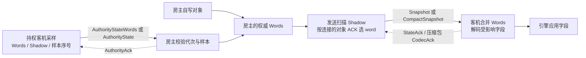
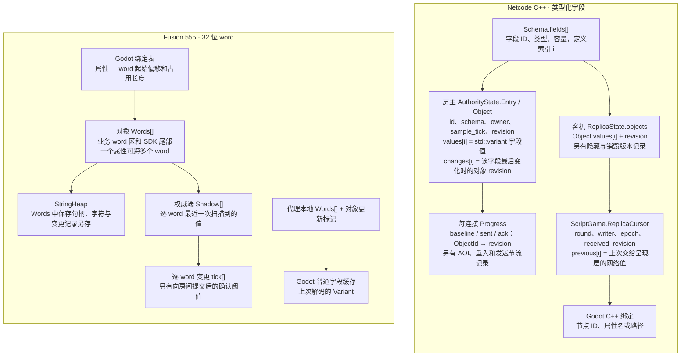
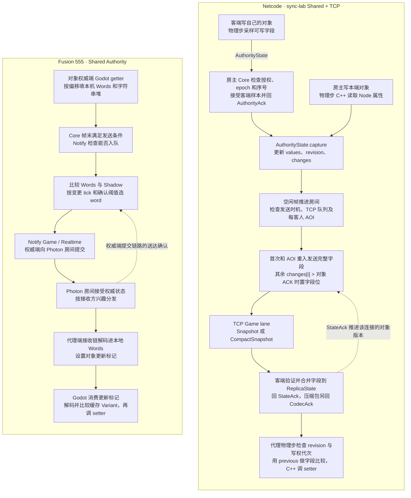

# 自研 Netcode 与 Photon Fusion Core v3 架构对比

从房间、输入和对象状态一路查到 Godot、Unity、Cocos2d-x 接入及掉线恢复，见[玩家联机同步全流程与技术选型对比](fusion-session-comparison.md)。开头记录指定提交的逐 word 实现和迁移前抓包。现行的下行快照、持权上行及其 ACK 合批条件见[运行时架构](architecture.md#一次状态更新怎样收发)。第 1 至 9 节对照早期 Direct 车场，第 10 节记录后续改造与验收。现行产品只支持同引擎房间。[联机范围与验收](specs/game-session.md#同引擎客户端同步)

当前通用会话可以按对象授权客户端写状态，或由房主结算、客人预测；两种模式均通过本地独立进程验证。对照 Fusion 3 的 13 项能力、各自使用的样例和实测等级见[本轮验收记录](../task/fusion-client-parity/验收/记录.md)。

## 逐 word 复制实现

本节以 `netcode` 提交 `9828d9e` 和 `examples` 提交 `25925e5` 的实现为准。`Words` 保存当前采样，`Shadow` 保存上次发送扫描结果，逐 word 版本独立于 ACK。模板固定字段偏移，客端保留最近提交的 `Words` 供增量合并，并保留解码值供引擎应用。Fusion Core 的公开契约使用 word 变更 tick，本项目使用对象版本或授权样本序号。字符串使用有界内联槽，Fusion 可用对象字符串堆。[Netcode 内存布局图](specs/property-binding.md#状态布局和差量) · [Fusion Core 对象与 Shadow](https://doc.photonengine.com/fusion-core/v3/manual/objects#shadow-buffer) · [Fusion 序列化](https://doc.photonengine.com/fusion-core/v3/manual/serialization)



| 记录 | 数据与确认 |
| --- | --- |
| 房主下行 `Snapshot` | 普通头含房间、局次、发送 tick 和记录数。活对象记录含对象身份、版本、采样 tick、模板身份和所有者。`kind` 为 5 或 6 时，状态体按数量、递增 word 索引的相对位置及 ZigZag varint 编码值写入。`kind` 6 另带场景与依赖。字段格式仍用 64 位掩码。 |
| 持权客机上行 `AuthorityStateWords` | 对象 ID、授权代次、样本序号、来源步、word 差量和恢复数据。房主在同代次最近接纳的值上合并后验证。只有源步或恢复数据更新时可发零个变更 word。 |
| 状态确认 `StateAck` / `AuthorityAck` | 分别确认接收端已处理的对象版本和房主已接纳的写权样本序号。快照压缩另用 `CodecAck` 推进字节锚点。 |

两端按连接协商 word 能力。首次或重入的完整基线、旧 SDK、启用量化的模板和更短的字段表示走字段格式。量化切换使用新版本完整基线，迟到的旧投影按版本过滤。授权引用的版本也会为相应接收方补齐。一个对象的 `Vector2` 只改一个分量时，按字段格式计算未压缩游戏负载为 63 B，逐 word 回归直接断言为 54 B。该数字适用于具体字段值和单对象记录，完整场景字节数还受变更密度、包头与压缩影响。[下行编码与 ACK](../core/state/replication.cpp) · [上行与授权](../core/session/object_authority.cpp) · [包长回归](../tests/core/replication_test.cpp) · [SDK 实测范围](sdk-validation.md#逐-word-修复版开发安装)

## sync-lab 迁移前的属性状态收发

本节及后续旧车场对照记录迁移前的字段编码基线。sync-lab 随附的插件仍可用于复现这组抓包和性能结果。

Netcode 基线使用 sync-lab 随附的 Windows Release C++ 构建 `5ce4ee1e67e62812/cbd0dce8d269280e`、原生 Shared、TCP 和 `apply_proxy_changes_only=true`。Fusion 使用原版 Godot Shared Authority Preview 555。已核对 sync-lab 本机 Fusion Windows 编辑器 DLL 的 SHA-256 与 555 指纹一致。Fusion 的调用和内存偏移来自同版本 Linux 原生库，普通字段行为另有 Web 双端验证。Photon Cloud 内部存储和服务端包处理细节缺少独立证据。[随附 Netcode 打包](../task/godot-platform/验收/T5.md#sync-lab-随附插件部署) · [Fusion 构建指纹](../research/fusion/builds/racing-3.0.0.md) · [Fusion 静态调用与 Web 实测](../research/fusion/findings/property-binding.md)

两边都先在本机保存状态，用独立的确认进度筛选变更，再把接收状态交给引擎。此版本的差异集中在内存单位、差量粒度、房间分发位置、确认对象和应用调度。下图表达字段、缓冲和索引的关系。Netcode `std::variant` 的大小和对齐由编译器决定。[Fusion 对象与 Words](https://doc.photonengine.com/fusion-core/v3/manual/objects)

### 内存结构



Netcode 保留完整的类型化对象值。`Values` 是 `std::vector<Value>`，`Value` 是 `std::variant`。字符串和变长容器管理各自的数据。`capture` 用当前 `Object::values` 比较新采样，变更时覆盖值并标记字段 revision。`ReplicaCursor::previous` 服务引擎应用。`SnapshotCodec` 的已确认字节锚点服务压缩。两份缓存和 `Progress::ack` 的职责不同。[类型定义](../core/state/value.hpp) · [采样](../core/state/replication.cpp) · [应用游标](../core/session/script_game.hpp) · [压缩锚点](../core/state/snapshot_codec.cpp)

Fusion 把属性按固定 word 偏移放到 `Words[]`，`Shadow[]` 保存上次扫描值。`WriteObjectRoot` 比较两者时更新 `Shadow` 和逐 word 变更 tick。`PacketDelivered` 独立推进发送端看到的房间确认阈值。因此 `Shadow` 已经等于 `Words` 时，该 word 仍可能待补发。555 Linux 的对象 `+0x1e8`、`+0x1f8` 分别用于读取 `Words`、`Shadow` 的数组指针，`+0xc8` 指向逐 word 记录，`+0xc0` 被用作对象确认阈值。字符串堆单独做变化记录。[Fusion Shadow 指令与确认字段](../research/fusion/findings/property-binding.md#core-中的-shadow-与确认布局) · [Fusion StringHeap](https://doc.photonengine.com/fusion-core/v3/manual/string-heap)

### 收发流程



Netcode 的物理步采样和房间空闲帧推进分开。普通 Shared 房间用 30 ms 的 Core 步长，房间每个空闲帧只调用一次 `advance()`，`pump` 先 `poll` 再 `flush`。默认 TCP 的 Game lane 可靠有序。发送方受排队门槛限制。TCP 最终送达、游戏状态合并以及场景 setter 完成是三个不同的时间点。`StateAck` 确认 Core 已解码处理的对象版本，发送时机早于节点回写。`AuthorityAck` 确认房主接受的写者样本序号，压缩 `CodecAck` 确认可被后续包引用的字节锚点。[Netcode Godot 调度](../engineplatform/godot/native_session.cpp) · [快照与 ACK](../core/session/game_session.cpp) · [客端写权上行](../core/session/object_authority.cpp)

Fusion 的公开 Core 循环是 `UpdateFrameBegin` 服务网络与应用接收包，`UpdateFrameEnd` 按发送时机处理脏 word。555 Godot 在线普通字段探针中，稳定权威字段 getter 次数跟随物理步。接收侧原版消费对象更新标记，再比较解码 Variant。Netcode 也省掉稳定代理的 getter 和 setter，但入口是每个已绑定代理检查对象 revision，变了才比较 Core 缓存的字段。Netcode 首次、AOI 重绑和写权代次变化走完整基线，其它字段类型和插值路径按各自合同处理。[Fusion 帧循环](https://doc.photonengine.com/fusion-core/v3/manual/frame-loop) · [Notify Game 的投递语义](https://doc.photonengine.com/fusion-core/v3/reference/notify-api) · [555 代理标记与回写](../research/fusion/findings/property-binding.md#接收更新标记与普通字段回写) · [Netcode 代理实现](../core/session/script_game.cpp)

### 线上数据形式

```text
Netcode TCP 消息外层
  lane:u8 | payload_size:u16 大端 | payload

Netcode 普通 Snapshot 内层，整数小端
  type:u8 | room:u64 | round:u64 | send_tick:u32 | record_count:u8
  对象记录
    id:u32 | revision:u32 | sample_tick:u32 | kind:u8
    可选 scene:u32 | dependency_count:u8 | dependencies:u32[]
    schema:u16 | schema_version:u16 | schema_fingerprint:u32 | owner:u32
    field_mask:u64 | 按 Schema 顺序写入命中字段的值

Netcode CompactSnapshot
  type:u8 | room:u64 | round:u64 | seq:varint | anchor:varint
  | 原普通快照体长度:varint | 压缩指令流

Netcode 状态确认和写者上行
  StateAck       = 通用消息头 | count:u8 | (ObjectId:u32, revision:u32)[]
  AuthorityState = 通用消息头 | ObjectId:u32 | epoch:u32 | sequence:u32
                   | source_step:u32 | 已授权字段样本 | 恢复数据长度及内容

Fusion 555 状态链路，已核对的结构层级
  Realtime 事件承载 Notify Game 分片
  → 对象状态记录、类型/创建及状态标志
  → word 位置差 + ZigZag / varint 的 word 值
  → 按对象标志携带的字符串堆变更
```

普通 Netcode 活对象记录的固定部分是 33 字节，`scoped` 额外携带场景与依赖。隐藏、销毁记录到 `kind` 为止。核心快照负载上限为 1,176 字节，每个快照最多 96 条对象记录。快照压缩在字段掩码生成后进行，只有编码变短才选 `CompactSnapshot`，接收端先恢复普通快照体。Fusion 的 ZigZag 及位置差来自 555 客户端的 `WriteDirtyWords`，图中未指定云端对客户端下行的完整字节布局。[Netcode 快照字段](../core/state/replication.cpp) · [应用头](../core/session/game_wire.hpp) · [TCP 分帧](../network/tcp/provider.cpp) · [Fusion 序列化](https://doc.photonengine.com/fusion-core/v3/manual/serialization) · [555 差量编码证据](../research/fusion/findings/property-binding.md#八人场剩余的房间推进开销)

2026-11-25 用随附 DLL 在本机跑了 32 对象无窗口双端。通过 `127.0.0.1` 透明转发核对 TCP 分帧及 Game 消息头，两端退出码均为 0，客机在全量窗推进了 31 个远端对象。采样窗口捕获到 377 个下行 `CompactSnapshot`，这次状态下行均使用压缩形式。样例压缩头为 `seq=2`、`anchor=1`、原快照体长度 581 字节。客端上行有 `CodecHello`、`CodecAck`、`StateAck` 和 `AuthorityState`，房主下行有 `AuthorityAck`。普通 `Snapshot` 由源码验证为压缩无收益时的分支。该次采集覆盖本地 Netcode，Fusion 侧仍采用上述客户端证据和公开契约。

| 同类数据 | Netcode 当前小球字段 | Fusion 公开布局与 555 观测 |
| --- | --- | --- |
| `offset: Vector2` | 字段位 4。只有该字段待发时，掩码为 `0x10`，普通包仍写 `x` 和 `y` 两个 `float32`。 | 在两个分量各用一个 word 的布局下，只变 `x` 就能按单个 word 发送。 |
| `version`、`sent_at` | Godot `int64` 转为固定 8 字节内容，Core 以 `bytes` 字段编码，普通包加 `u16` 长度。 | `int64` 由低、高两个 word 构成，可以独立跟踪变化。 |
| `active`、`label` | 布尔普通包占 1 字节。字符串写 `u16` UTF-8 字节数和字符，整个值一个字段。 | 布尔占一个 word。字符串的两个 word 保存句柄，字符在独立的字符串堆。 |
| `trail`、`tags` | 按实际元素数编码 `PackedInt32Array` 和 `PackedFloat32Array`。配置上限为 4，任一元素变化可置整个字段的位。 | 公开数组布局是计数加按容量预留的 word 槽，同一容量下改变现有元素数不改变布局用量。 |

这张表说明字段单位和 word 单位的差异。最终包字节数还受待确认的其它变化、快照压缩、量化和包头影响。原生 Shared 的对象写权可交给客端，快照依然由房主汇总分发。RPC、房间和预测输入走各自的消息路径。此节的字段掩码和两种 ACK 示例只覆盖属性状态及其字节压缩。[sync-lab 字段资源](../../examples/sync-lab/netcode_orb_config.tres) · [Netcode 值编码](../core/state/value.cpp) · [Fusion 类型映射](https://doc.photonengine.com/fusion-core/v3/manual/serialization) · [Fusion 原版布局实测](../research/fusion/findings/native-runtime.md)

### 通用玩法接入历史验收（2026-11-21）

| 能力 | 当时覆盖 | 当时的使用边界 |
|---|---|---|
| 字段与集合 | 16 类字段。三组同引擎控制台均验证了整数表、保留重复值的列表，以及从引用找到本地刚体。 | 当时的协议按完整字段发送集合。现行布局见 [逐 word 复制实现](#逐-word-复制实现)。 |
| 类型化 RPC | 可登记有名称、稳定方法号和参数模板的对象或房间方法，接收端校验签名，按写权限制分发到玩法回调。 | 每次调用的参数编码预算为 252 字节。静态源码生成仍是后续项。 |
| 自动同步组件 | 三端均可绑定玩法成员、同步二维及三维原生刚体，并随对象写者变更切换采集和应用。 | 场景实例需要绑定会话和对象号；Cocos2d-x 三维刚体需显式绑定。 |

以上是自研运行结果。原版参考、验收范围与同引擎双进程证据分别见[本轮对照计划](../task/gameplay-components/执行计划.md)、[玩法契约](specs/game-session.md#玩法字段命名调用与挂载组件)和[本机报告](../task/gameplay-components/验收/本机.md)。

第 1 至 9 节保留初版车场与当时原版构建的逐项比较。文中的房主集中写入、两类字段和全场广播均指该历史版本；后续实现进度见第 10 节及[能力路线图](roadmap.md)。

**改造前最接近 Fusion 的部分是状态复制。** 两边都把引擎绑定、权威状态、差量选择、接收应用分开，并用最后变更记录与确认进度驱动重发。**影响架构最大的差异是权威和分发拓扑。** Racing 由各对象所属客户端提交状态，经 Photon Cloud 分发。最初的车场版本由同一个房主模拟整个世界，再直接同步给各客人。这个差异决定了输入怎么走、谁发 ACK、掉线后从哪里恢复。

自研侧以本仓库的 C++17 `core/`、车场运行时和 Windows x64 的 Godot、Cocos2d-x 与 Unity 适配器为准。原版以本地 **Fusion Godot Racing 3.0.0 Shared Authority** 随包源文件与指纹已核对的 Linux 原生库为静态证据。原版另有 Windows 编辑器运行证据和 Web 原版 Shared、Host 两个普通玩家进程的在线观测。本文只比较客户端和可观察的房间结果。[Netcode 状态收发图](architecture.md#一次状态更新怎样收发) · [Fusion 原版调用与指令证据](../research/fusion/findings/property-binding.md#原版调用与指令证据) · [原版构建指纹](../research/fusion/builds/racing-3.0.0.md)

## 1. 模块、进程与权威

2026-11-20 的补充拆解追到了预测输入、RPC 分流、对象依赖、字符串堆、时钟和刚体校正的原生分支。Windows 离线探针另测了原车的实际配置、类型布局与 getter。后续对照补齐了 295 个注册方法、两个命名空间的 360 个函数起点及原版双端房间轨迹。[客户端拆解与项目差距](../research/fusion/findings/client-audit.md)

| 层级 | Fusion Core v3 / Racing | 初版车场 |
| --- | --- | --- |
| 游戏与适配层 | Godot 的场景和脚本声明复制字段。原生 `FusionSharedReplicator` 把 Godot 属性读写映射到网络对象。随包 C# 包装转发给 Godot 原生类 | `replicators.cfg` 是两种引擎的共同字段契约。Cocos 的 `YardScene` 和 Godot 的 `NetcodeYard` 驱动同一个 `Runner`。Cocos C++ 或 Godot GDScript 负责节点生灭、路径、坐标和渲染 |
| 核心入口 | `FusionCore::Client` 组合对象、场景、RPC、兴趣和所有权，对外提供收包与发包的帧边界 | `netcode_core` 提供 `AuthorityState / ReplicaState`、`RoomHost / RoomGuest` 和 `Rpc`。示例仓的 [`yard/shared/Match`](../../examples/yard/shared/match.cpp) 负责调度与车辆规则。 |
| 传输分层 | `FusionCore::Notify` 负责通道、分片、交付通知。原版二进制中 `PhotonNotifyPlatform::Send` 调用 `PhotonMatchmaking::RealtimeClient::SendEvent` | `Transport` 提供 `poll/send/close`。`netcode_direct` 是单独的 Windows Winsock 后端。房间和游戏分别走 TCP 与 UDP，另有内存后端供离线测试 |
| 权威部署 | Racing 使用 Shared。对象权威可由不同玩家持有，Photon Cloud 接收并分发当前状态。产品另有 Client-Server 模式，可由客户端房主或专用进程做模拟权威，分发仍经 Photon 房间 | 只有房主进程能提交整个世界的权威状态。车辆的 `owner` 把某位客人的输入与 RPC 绑定到这辆车。Cocos 或 Godot 都可以作为房主 |
| 房主离开 | Shared 的 Master Client 角色可重新分配。对象是否保留、迁移或销毁还取决于其所有权策略 | 房主是唯一世界权威。房主退出或失联后，客人结束该房间。当前实现的恢复范围是客人重连仍在运行的房主 |

Racing 中每个客户端都可以是自己车辆的写入者。场景 `vehicle.tscn` 的 `owner_mode = 1` 与随包 `FusionEnums.cs` 的 `PlayerAttached = 1` 对应，车辆脚本使用 `has_authority()` 决定谁写。自研车场中，`Match` 用连接识别驾驶者，再在房主模拟中写值。把引擎从 Godot 换成 Cocos，传输协议与房主写权保持一致。[Fusion 拓扑](https://doc.photonengine.com/fusion-core/v3/getting-started/modes-and-topologies) · [Godot 对象权威](https://doc.photonengine.com/fusion-godot/v3-shared-authority/manual/replication/ownership-modes) · [本项目构建边界](../core/CMakeLists.txt) · [车场调度](../../examples/yard/shared/match.cpp)

## 2. 同一个油门字段怎样走完整链路

以客人在本机把输入从 `0` 改为 `0.75` 为例。这里统一数值做对照。Racing 的 `net_input_x` 是左右输入，自研车场的同名标记字段记录油门，两者的业务含义由各自示例定义。

| 阶段 | Fusion Racing Shared | 自研车场 |
| --- | --- | --- |
| 产生值 | 车的权威客户端在 `vehicle.gd` 读本机输入并直接写脚本字段。场景以 `NodePath(".:net_input_x")` 声明复制 | 客人把当前控制量提交到 `Runner / Match`。UDP `Input` 带递增序号、`throttle` 和 `steer`。房主按实际连接找到驾驶者 |
| 决定新状态 | 原生 Godot 绑定按节点与属性名调用 getter，将返回值编码到对象的固定 word 槽 | 房主拒绝未就绪、旧序号或越界控制量。约 30 Hz 固定步推进车的位置与转向，把新状态和控制值交给 `AuthorityState::capture` |
| 发出 | 发送阶段对 `Words` 和 `Shadow` 做扫描，`WriteDirtyWords` 选出尚未确认的变更，通过 Notify 发往云端 | 约 20 Hz 在 `AuthorityState::packets` 中逐客人比较字段版本和该客人的对象 ACK，直接发送 `Snapshot` |
| 应用 | Photon 房间把状态分发给相关客户端。客户端经 `StatePacketReceived → ReadObjectData` 合并其对象状态，再由 Godot 绑定写到场景 | 客人经 `ReplicaState::apply` 校验并合并完整数据报，发 `StateAck`。适配器随后把权威值应用到场景 |
| 平滑 | Racing 的三个自定义字段关闭单属性插值。根刚体独立启用 `AUTO / Forecast`，原车校正模式实测为 Blend，最大外推时间 0.25 秒。3D Blend 原生分支写入线速度与角速度 | `net_input_x` 等业务字段直接应用。视图的变换从当前显示值向新目标插值约 100 ms。旋转选最短角路径 |

因此，对自研车场按键后收到本机回写的 `0.75`，已经经过客人上行和房主模拟再下行。对 Racing 的对象权威端，脚本赋值后就可读取自己写入的值。它向云端提交后，其他客户端才收到该值。[原版属性绑定指令](../research/fusion/findings/property-binding.md) · [原版字段复制](https://doc.photonengine.com/fusion-godot/v3-shared-authority/manual/replication/syncing-properties) · [自研输入与模拟](../../examples/yard/shared/match.cpp) · [Godot 显示应用](../../examples/yard/godot/yard/replicator.gd)

## 3. 对象身份、布局与绑定缓存

| 项目 | Fusion Core v3 | 初版车场 |
| --- | --- | --- |
| 身份 | `ObjectId` 公开结构为 16 字节，由创建者、地图和计数组成。`TypeRef` 用类型哈希与 word 数说明分配规格 | `ObjectId` 为 `u32`，同一局单调分配。游戏消息另带 `u64 RoomId` 和 `u64 RoundId`。`SchemaId` 与字段 ID 是 `u16` |
| 当前状态 | `Object::Words` 是定长 32 位 word 区，属性由固定偏移解释。公开布局预留 18 个尾部 word。具体属性的压缩与序列化由绑定决定 | `Object::values` 是 `vector<variant<float,bool>>`。二维、三维变换被配置展开为标量字段。单 schema 最多 64 个字段。线上只支持有限 `f32` 与单字节 `flag` |
| 存储核验边界 | Racing 的 Windows 插件在测试刚体上返回 `15、16、17、18` 个配置 word，分别对应 AUTO 加 0、1、2、3 个额外标量。这组观测描述 `compute_word_count` 的返回值，Core 对象总布局另依公开契约 | 活对象记录显式携带 schema ID、版本、字段 ID/类型指纹与 64 位掩码。接收方校验布局后按位解码，可拒绝本地配置和远端不匹配的记录 |
| 引擎引用 | 已核实 Linux 原生普通属性缓存保存节点指针、实例 ID、属性名和路径。常规采集经缓存调用 getter，把值写入 `base + 4 × offset` | 核心值没有引擎指针。配置给出路径，适配器按对象 ID 找本地实例，再从实例解析根或子节点。绑定与显示数据驻留在适配层 |

按内存职责看，Fusion 用两份同尺寸 word 数组承载当前值和上次扫描值，再配逐 word 变更记录。我们的权威对象用最近一次采样同时承担当前状态与下次比较基准。若比较实际内存，占用还取决于对象记录、容器容量、连接数和引擎侧缓存，单看一个字段的线上字节数无法回答。[Fusion 类型和布局](https://doc.photonengine.com/fusion-core/v3/manual/architecture) · [Fusion 对象缓冲](https://doc.photonengine.com/fusion-core/v3/manual/objects) · [原版布局探针](../research/fusion/probes/README.md) · [自研类型](../core/state/replication.hpp)

## 4. Shadow、ACK 与丢包重发

| 机制 | Fusion Core v3 权威端上行 | 自研房主下行 |
| --- | --- | --- |
| 比较发生在何时 | `CheckForMutatedState` 在发送阶段逐 word 对照 `Words / Shadow`。有差异时覆盖 `Shadow` 并记变更 tick | `capture` 采样时比较新旧字段值。若内容变化，对象 `revision` 加一，只更新对应 `changes[i]`，并保存新值和 `sample_tick` |
| 筛选条件 | `WriteDirtyWords` 使用 `wordChangeTick > ackThreshold`。原生库中确认回调 `PacketDelivered` 与 Shadow 扫描独立 | `packets` 使用 `changes[i] > peer.ack[object]`。每位客人的 `Progress` 保存 `baseline / sent / ack` 三张对象版本表 |
| ACK 的含义 | 当前权威客户端到 Photon 传输链路的已确认进度。某位对端什么时候应用到节点是后续问题 | `StateAck` 里的对象 ID 与版本代表客人副本已成功处理该数据报。旧记录可再确认，房主只单调推进到已发送过的版本范围内 |
| 重发内容 | 从最新 `Words` 读取仍待确认的数据。原版静态核实了扫描和筛选路径，线上双方的时间轨迹还需双端验证 | 下一次发送重新选最新字段。若同一字段又变，复制最新值。可靠 RPC 走自己的队列。单次状态报的数据报解析成功后才提交 |

自研示例中 B 和 C 都已有车辆。位置在版本 11 变化，油门在 12 变化。B 只确认到 10，C 已确认到 11。房主发送版本 12 给 B 时带位置与油门，给 C 时只带油门。B 对 12 的 ACK 丢失时，房主仍按 B 的确认进度筛选。B 识别重复版本并再次 ACK，已应用的状态保持单调。即使位置后来变回旧值，它最新的变更版本依然会进入尚未确认的差量。

Fusion 的对应演算是对象 word 在发送 tick 101 变更，Shadow 当场更新。tick 102 该 word 无新变化，但云端确认仍停在 100，已经登记的 101 仍可进入下一包。两套算法都把**上一次比较看到的值**和**对面确认到的进度**分别保存，因而能在没有新变化时继续补发。[Fusion Shadow 契约](https://doc.photonengine.com/fusion-core/v3/manual/objects#shadow-buffer) · [原版 Shadow 指令与确认布局](../research/fusion/findings/property-binding.md) · [自研采集、打包与 ACK](../core/state/replication.cpp) · [复制回归](../tests/core/replication_test.cpp)

## 5. 传输、包格式与 RPC

| 维度 | Fusion Core v3 | 初版车场 |
| --- | --- | --- |
| 控制与连接 | Realtime 负责连接、区域和房间。Notify 在其上承担游戏层通道。原版库能核实 `Notify::Connection`、`PhotonNotifyPlatform` 与 `SendEvent` 的路径 | 房主同一端口开 TCP 和 UDP。TCP 长度帧承载房间消息、250 ms 心跳和 UDP cookie。默认超时 3 s。UDP 按 cookie 与端点匹配实际连接，游戏头检查房间与局次 |
| 状态与投递 | Notify 的 Game 承载非可靠状态，Streaming 承载可靠投递，Unreliable 承载不可靠 RPC。通道层维护分片和交付通知 | 快照按游戏负载上限拆成独立完整的数据报。`Snapshot / StateAck` 服务状态收敛。`Rpc / RpcAck` 管调用序列，两个 ACK 用途独立 |
| RPC 寻址 | Core `CreateUserRpc` 接收目标玩家、目标对象、事件哈希和数据。Godot 包装支持对象目标或注册的广播接收器 | 方法表固定方法 ID、方向、作用域、可靠度和参数长度。方向沿用 Unreal 风格 `Server / Client / NetMulticast / Remote`，房间方法使用对象 ID `0` |
| RPC 顺序和重试 | 可靠和不可靠 RPC 经独立缓冲进 Notify 的 2、3 号通道。可靠分片丢失时重新入队，对象状态确认另外推进。原版 Web 已记录同对象可靠 0 至 3，以及两对象混发可靠和尽力消息的一次实际到达序列。该样本不能推导全局顺序 | 按发送方、接收方、对象或房间分别建可靠流。窗口 64、实例可靠队列上限 256、约每 100 ms 重试。累计 ACK 推进连续序列，断线或换局清流。跨流及属性之间可交错 |

**自研协议的字节例子。** `Snapshot` 的共同游戏头、发送 tick 和条数共 22 字节。每个活对象记录的固定部分为 33 字节，再加掩码选出的属性值。一个对象、一个 `f32` 变化的示例为 **59 字节游戏负载**，加 20 字节自研 UDP 封装为 **79 字节**。同样一个对象的 `StateAck` 是 26 字节游戏负载，加封装为 46 字节。数字来自字段宽度，取值粒度为一个数据报，范围止于 UDP 应用负载。游戏负载上限为 1,176 字节。Fusion 在线总包长受编码、通道与底层传输影响，原版在这里没有同场抓包数据。[Fusion Notify](https://doc.photonengine.com/fusion-core/v3/reference/notify-api) · [Fusion Core Client API](https://doc.photonengine.com/fusion-core/v3/reference/client-api#rpcs) · [Fusion Godot RPC](https://doc.photonengine.com/fusion-godot/v3-shared-authority/manual/rpcs/basics) · [自研包头](../core/session/game_wire.hpp) · [自研 RPC](../core/session/rpc.cpp) · [Windows 传输](../network/direct/direct.cpp)

开门展示了状态和事件的职责。客人从自己的车发 `TryOpen`。房主校验车辆归属和距离，成功时改写门的 `is_open`，也可广播 `RoomNotice`。`RpcAck` 只表示收到对应可靠序列，开没开门从业务回复或权威字段判断。Fusion Godot 同样把迟加入需要看到的结果放到复制属性中，一次性 RPC 随调用投递。[房间与对象 RPC 规格](specs/rpc.md) · [开门实现](../../examples/yard/shared/match.cpp) · [Fusion Godot RPC](https://doc.photonengine.com/fusion-godot/v3-shared-authority/manual/rpcs/basics)

## 6. 创建、销毁、兴趣与重连

| 场景 | Fusion Core v3 / Racing | 初版车场 |
| --- | --- | --- |
| 首次出现对象 | 地图对象按稳定 ID 查找复用，未命中才分配。远端处理状态后，`TryFireObjectReady` 逐项检查依赖对象，满足条件后给根对象发一次就绪通知 | 房主给对象分配新的单调 ID 与模板。未确认对象的客人收到完整字段。客人首次收到完整有效记录后，适配器按模板生成节点 |
| 销毁 | 原版状态处理含 `DestroyObjectFromRemote` 路径。Cloud 为晚加入者维护当前生成集合和状态 | 房主留下带更新版本的销毁记录并对有关客人送达。客人删除节点并保留销毁版本，迟到的已删除对象旧包无法复活节点 |
| 可见范围 | Core 支持对象兴趣策略、AOI、子对象与对象依赖。进入兴趣范围时按当前完整状态初始化 | 初版车场向已就绪的客人同步全场对象。子节点字段隶属于同一个网络对象。现行 Godot SDK 还支持按玩家订阅过滤对象，动态进出已通过双进程验收。[空间网格验收](../task/godot-platform/验收/T6.md) |
| 新玩家晚加入 | 开放的 Photon 房间可让晚加入者从云端收到当前生成对象与状态 | 房间等待时可加入。开局进入 `Playing` 后，普通新加入返回 `Locked`，本局旧成员走 `Resume` |
| 原成员重连 | Realtime Core 公开 `PlayerTtlMs`、保持身份与 `JoinRoomOptions::Rejoin`。具体对象的寿命与主人变化仍依其策略。Shared 默认设置下 A 正常退出后，B 接任 Master，同一 User ID 普通再加入得到新玩家号。保留非活跃身份后显式 Rejoin 的同条件路径仍待测 | 房主核验 `RoomId/RoundId/PlayerId/Key`、成员离线状态，原玩家与原车不重建。客人的新连接从空副本和零 ACK 开始恢复。恢复票据目前保存在同一客人进程内 |

自研恢复还有一道**开回原车的门槛**。`attach` 为当时存活对象登记最小需确认版本。较新的有效对象版本也能达标，基线对象期间被销毁时用其销毁记录推进。基线达成后房主发 `Ready`，客人同时看到自己的原车才恢复发送控制量。恢复期间新生成的对象继续走常规快照。场景基线是这批对象的最低版本门槛，整个世界无需暂停等一份统一帧。[Fusion 生成和迟加入](https://doc.photonengine.com/fusion-godot/v3-shared-authority/manual/spawning) · [Fusion Interest Area](https://doc.photonengine.com/fusion-core/v3/manual/interest-area) · [Realtime 房间重入](https://doc.photonengine.com/realtime-core/v6/manual/rooms-and-players) · [自研恢复校验](../core/session/room.cpp) · [自研恢复规格](specs/room-rejoin.md)

## 7. 帧循环、预测与显示

| 维度 | Fusion Core v3 / Racing | 初版车场 |
| --- | --- | --- |
| 帧边界 | 公共契约要求集成按 `UpdateFrameBegin → 引擎读取/模拟/写入 → UpdateFrameEnd` 前进。原版库核实 Begin 服务 Realtime、End 排队状态与 RPC。Web 普通浮点字段在稳定 Shared 房间 60 与 30 Hz 下，权威端每 60 个物理步各读 60 次，代理各读 0 次 | `Match::update` 轮询网络，房主按固定节奏补模拟步，再走独立发送时钟及 RPC 重试。`sample_tick` 是采样时点，`send_tick` 是发送步，`revision` 只在对象状态变化时推进 |
| 控制与预测 | Racing Shared 由车主本地模拟并发布状态，远端刚体使用 Forecast。同一构建的 Client-Server 分支单独发送带序号与时长的输入，返回已消费序号，清理已确认输入后可重置模拟并重演剩余输入。一轮 60 条标记输入在 Host 上各消费一次，预测端回调 476 次 | 客人周期发最新控制量，房主拒绝旧序号，超过八个模拟步无新输入后用零输入。当前客人等待权威状态回写，使用显示插值。核心保留最新已提交状态。可重放的逐 tick 状态历史尚未实现 |
| 显示状态 | 已收到的权威 word、绑定解码状态以及刚体 Forecast 或显示平滑处在不同阶段 | Cocos 的 `from/to/display` 和 Godot 的 `previous/target/displayed` 与客人已提交的 `ReplicaState` 分开。到达时间与插值结束时间可分别观测 |

在延迟下，这一区别直接影响体验。我们的客人要经过上行、房主采样和下行才取得新车辆状态，然后画面平滑追上。Shared 权威车的本地输入可直接推进自身逻辑，远端刚体还能根据最近速度外推。Fusion Authority 的输入预测与纠偏是另一条路径，属于产品能力对照。[Fusion 帧循环](https://doc.photonengine.com/fusion-core/v3/manual/frame-loop) · [Fusion Ownership 与输入预测](https://doc.photonengine.com/fusion-core/v3/manual/ownership) · [Godot Forecast](https://doc.photonengine.com/fusion-godot/v3-shared-authority/manual/physics-replication) · [Cocos 插值](../../examples/yard/cocos2dx/replicator.cpp)

## 8. 扩展成本与已验证边界

| 问题 | 初版车场的实际边界 | Fusion Core v3 可对照项 |
| --- | --- | --- |
| 增加客人和对象 | `AuthorityState::packets` 逐客人遍历对象表，然后对需要发送的对象检查字段版本。本机验收覆盖 4 人、100 活动对象。公开互联网和更大场景缺少同等实测 | 有兴趣筛选、对象依赖、不同发送配置。SDK 和云房间内部的资源上限以及这个负载的实际吞吐未在本地比较 |
| 客人暂停与恢复 | 预设 1,050 ms 同进程离线试验中回到玩家 2 的原车。离线期间短命对象 6 被删，对象 7 保留。无故障与注入故障两轮分别约 1,216 ms 和 1,183 ms 恢复，轮内状态摘要一致 | Windows 离线实测覆盖原车配置和属性布局，Linux 静态证据覆盖客户端调用与字段缓冲。原版 Web 已验证晚加入、属性跨端回写、Master 交接与重新加入。Windows 原生区域查询保留独立失败记录。相同暂停窗口下的身份恢复时延尚无原版对照 |
| 应用彻底退出 | 关窗口或杀进程后，新进程当前发普通 Join，进行中收到 `Locked`。同进程 `ResumeTicket` 与活着的房主是已验证的恢复前提 | 可配置非活跃玩家保留及同身份重入。Web 新会话按普通加入取得新玩家号。C 直接关闭浏览器后 B 收到 `player_left(3,false)`。显式重入仍需设置相应 TTL |
| 历史适配器诊断 | 初版曾在同机运行 Godot 与 Cocos 的两个互换房主用例，检验车场共用代码在两个适配器上的表现 | 官方 Core 面向不同引擎集成。本地静态证据的对象是 Godot Racing 的这一份构建 |

自研四端故障轮记录 150 次丢弃、207 次重复、186 次乱序。冻结后四端的摘要一致，摘要覆盖对象 ID、模板、所属和全部编码字段。这验证指定负载下的恢复与最终一致性。该轮另记录了开门 RPC、属性同步、出生销毁及混合引擎诊断。[Godot 验收报告](../task/godot-platform/验收/验收.md) · [Cocos 验收报告](../task/cross-engine-sync/验收/M6.md) · [原版探针与错误](../research/fusion/probes/README.md) · [现行验证入口](architecture.md#验证与复现)

## 9. 哪些设计借鉴到什么深度

| 判定 | 具体部分 | 对当时工程的含义 |
| --- | --- | --- |
| 机制级借鉴 | 无引擎状态层、引擎属性绑定、最近比较值、逐字段变更版本、独立确认进度、持续发最新值 | 能用同一组丢包和重发推演解释两边。编码长度、比较时机和确认链路由各自实现决定 |
| 职责级借鉴 | 状态、可靠事件和尽力事件有各自收发语义。加入或重新看到对象时以完整状态初始化 | 借鉴的是各链路该保证什么。我们的线协议格式、RPC 滑窗、TCP/UDP 划分、恢复票据和 `Ready` 流程由本项目定义 |
| 独立设计 | 房主集中模拟、四人锁局、按连接校验驾驶与 RPC、拒绝普通中途加入、全场基线恢复 | 把玩家身份、客人连接、车辆对象寿命和局次拆开，契合当前车场的部署和续玩规则。RPC 路由还参考了 Unreal 的执行方向 |
| 产品能力差距 | Cloud 房间与分发、兴趣筛选、多地图与子对象、多种权威策略及 Authority 模式下的预测接口 | 这些会影响部署、对象身份、可见集合或模拟时钟。自研目前完成的范围以仓库验收和明确的运行契约为准 |

现行 Netcode 由三种引擎复用同一个 Core，各自提供同引擎联机。复制层借鉴 Fusion 的 Shadow、变化标记和确认进度。对照时最应保持清楚的是两个逻辑边界，即 Fusion 的权威端对云房间与自研房主对某个客人。[本项目引擎边界](decisions/engine-boundary.md) · [传输设计来源](decisions/game-transport.md) · [首版运行契约](decisions/first-edition-runtime.md)

## 10. 当前项目的改动顺序与交付能力

这份历史清单记录了通用游戏同步框架的实施顺序。客户端写权已列入核心契约，游戏按对象选择写入者。离散机关验证授权、提交、分发和回收，赛车另行验证连续运动与输入重演。[框架契约与接入边界](specs/object-authority.md) · [原版双端实测](../research/fusion/findings/client-audit.md)

| 框架优先级 | 改动落点 | 能力验收 |
| --- | --- | --- |
| 1. 对象写权与会话 | 在 `core/session` 将状态写权与业务归属、输入权限分开，按对象授权、确认来源、切换代次、从最后接纳状态接管。 | 一个房间内两个客户端分别操作各自获权的对象，旁观者收敛，越权和过期状态均无效。 |
| 2. 通用状态与模型注册 | `core/state` 管字段、版本、基线和确认。游戏登记状态结构、验证规则和恢复数据。适配器绑定到引擎实例。 | 离散拼图与连续角色复用同一套网络接口，新增玩法只增加模板和规则。 |
| 3. 可选的输入预测和呈现 | 让可预测模型挂接输入历史、同一步检查点和重演，按模型选直接呈现、插值或有界外推。 | 拼图无须运行模拟也可同步，角色可在等待回包时响应，回合倒计时可直接用网络时间显示。 |
| 4. 分发范围和场景 | 按每位接收者筛选可见对象，补齐重新进入或换图后的基线与对象依赖。 | 观察者只接收所需对象，重新进入后看到当前状态，世界中已销毁的对象保持缺席。 |

### 原改造清单与现行实现

截至 2026-11-21，四项均已有运行时入口。固定步回放和快照插值在 Core，可由其他玩法提供状态、输入和单步函数。通用字段配置可直接加载背包或计分板模板，场景分发可按每位玩家的对象集合过滤。车场提供三引擎验证，拼图覆盖离散操作、不同玩家的可见集合、跨场景依赖和重入。下表留作改造前的需求与对照。[通用预测](../core/state/prediction.hpp) · [配置入口](../core/state/layout.hpp) · [按玩家复制](../core/state/replication.hpp) · [验收](../task/cross-engine-sync/验收/M6.md)

房主裁决车辆运动时可验证 Client-Host 的输入预测。玩家持有车辆状态写权时可验证授权提交和接管。这两条路径分别验收。下表中的序号属于车场实施顺序。[Photon 对两种模式的定义](https://doc.photonengine.com/fusion-core/v3/getting-started/modes-and-topologies)

| 优先顺序 | 在当前项目改什么 | 做完可交付什么，怎样证明 |
| --- | --- | --- |
| 1. 自车预测和纠偏 | 从 `Match::simulate` 抽出房主和客人共用的车辆单步，包含位置、朝向、有符号车速和碰撞输入。给客人提供房主模拟步和步长，在 30 Hz 固定步保存带目标步的输入，以现有 20 Hz 游戏通道批发近期输入。房主按目标步去重和结算，回传同一步的完整车辆状态及已结算的输入步。客人恢复该步，重演后续输入。给新消息协商协议版本，沿用现有状态 ACK 和可靠 RPC。 | 在静态场地暂扣下行 150 ms，自车下一本地固定步移动。单独扰动车速，让车在收到权威检查点后回到同输入参考轨迹。重复的输入在房主只裁决一次，回放不会重复触发游戏事件。[车场收包与模拟](../../examples/yard/shared/match.cpp) · [游戏消息](../core/session/game_wire.hpp) · [时序与验收草案](specs/physics-prediction.md) |
| 2. 三端显示、碰撞环境和恢复 | Unity、Godot、Cocos 分开本机预测姿态和远车权威快照。远车按房主模拟步缓冲和播放，自车仅在显示层平滑纠偏。为开门、增删路障记录生效步，重演时用当时的碰撞环境。历史超窗时重新从完整权威状态起步。重连时从原车当前速度和当前环境启动新输入代次，拒收旧代次包。 | 三种前端的驾驶者都能立即操控，旁观者看到平滑的权威运动。丢包、乱序、碰撞修正和掉线恢复后保持原玩家和原车。三个引擎分别用本引擎双端验收，共用 C++ 模型。[三端接入设计](decisions/physics-prediction.md) · [Unity 显示](../../examples/yard/unity/Assets/YardReplicator.cs) · [Godot 显示](../../examples/yard/godot/yard/replicator.gd) · [Cocos 显示](../../examples/yard/cocos2dx/replicator.cpp) |
| 3. 让新玩法能直接使用复制组件 | 现有 schema 已有稳定字段 ID、版本和指纹。扩展类型、量化与容量规则，从 float/bool 扩至业务需要的整数、向量、旋转、字符串和有界数组。同步修改编解码、配置解析、三端类型接口和节点读写。Unity 的 `ny_object` 当前只接收 `float[]`。新增模板由配置注册采集和应用，失效节点按明确规则重绑。变长字段按 1,176 字节游戏负载预算验证，选择限制长度或实现有界分片。 | 用已有门和一个新增可拾取道具验证。道具的数量、名称、列表由配置同步，网络层无需增加道具分支。验收包含重连基线、空串、数组缩短、子节点释放重建、模板版本不兼容和旧房间回归。[字段与 schema](../core/state/replication.hpp) · [配置入口](../../examples/yard/shared/layout.cpp) · [Unity 托管接口](../../examples/yard/unity/Assets/NetcodeYard.cs) |
| 4. 按客人分发对象、按依赖加载场景 | 从 `AuthorityState::packets` 的全场遍历加入每客人的可见对象集合。离开视野单独记录，重新进入发当前完整基线，防止旧包覆盖新实例。跨场景对象再加场景身份、依赖和对象级 Ready。若玩法要中途加入，另调整房间当前的开局锁员规则。 | 玩家订阅区域或队伍后只收到匹配对象。离开时本机移除，离开期间对象若改变，回来取得新值。世界已销毁的对象持续缺席。跨场景依赖晚到时，根对象业务回调等到所需对象齐备。规模收益用实际可见对象数和每客人字节数衡量。[现有复制与销毁记录](../core/state/replication.cpp) · [房间准入规则](../core/session/room.cpp) · [Fusion 兴趣模型](https://doc.photonengine.com/fusion-core/v3/manual/interest-area) |
| 可选的 Shared 风格对象写权 | 另存状态写入者、授权代次和生效步。保留车辆业务归属和 RPC 校验。授权驾驶者提交本车状态，房主校验、发布并能接管。相互施力的车辆交给同一个权威模拟。此项可独立于区域筛选实施。 | 用房主、驾驶者、旁观者验证换人驾驶、客人离线接管及旧写入失效。能复现每人写自己车的体验。房主进程本身退出后继续同一局，还需其他玩家持有可恢复的世界与会话检查点，完成选主、端点切换和重连。[对象写权设计](decisions/physics-prediction.md#可选的客机状态权威) · [原版 Master 离开后的观测](../research/fusion/findings/client-audit.md) |

**时钟和恢复状态的修复。** 客人现在从房主模拟步和对象采样步观测时间。发包序号只用于标识发送批次。检查点携带有符号车速和已处理输入序号，即使车身字段没有变化也能裁剪输入历史。仅扰动车速的对照试验覆盖了同一位置与朝向却有不同后续轨迹的情形。[检查点协议](../../examples/yard/shared/match_prediction.cpp) · [可重复实验](../../examples/tests/prediction_test.cpp)

**交付上限由验收决定。** 前两项通过后，可称为三端共用车辆模型的玩家房主预测框架。用现有同机 4 人、100 个复制对象作回归基线，再分别测弱网下的输入到首个可见移动时间、纠偏距离、重演 CPU 和每客人带宽。已有 100 对象用例含 4 辆车和 94 个负载对象。若旁观者要看到临时断包时仍在运动的刚体，可再同步线速度、角速度和睡眠状态，短时外推并按权威样本纠正，传送时清空播放缓冲。用撞墙、传送和唤醒分别验收。多车互撞、推箱、关节等的原生物理重演需要按后端另验隔离世界、成组恢复和单步重演。第 3、4 项把适用范围扩大到更多业务对象与场景。跨地域匹配、中继、网络可达性和更大并发另有部署与压测条件。[既有负载实测](../task/cross-engine-sync/验收/M6.md) · [弱网与物理验收](specs/physics-prediction.md#可执行的验收顺序)
