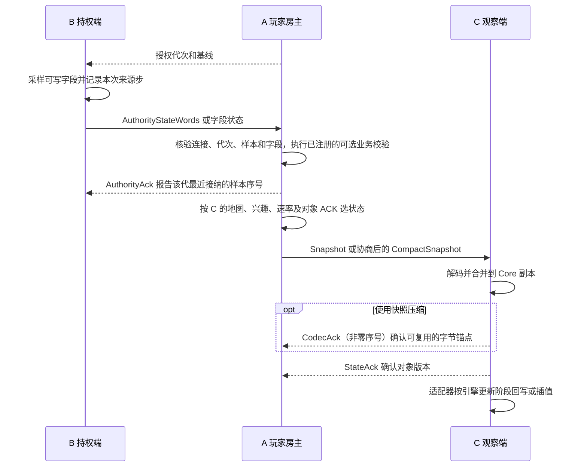

# Photon Fusion 与 Netcode 的联机同步全流程对比

**2026-11-26 · 玩家开房与共享权威 · Core、Godot、Unity、Cocos2d-x**

下表标识此次对照所用的 SDK。后续工作区在可靠有序的 Game 通道上增加了持权上行状态及回执的协商合批；现行收发路径和条件见[运行时架构](architecture.md#一次状态更新怎样收发)。

两套方案最接近的地方是**对象状态怎样从写者传到观察者**。双方都能把属性映射为定长 word，记录变化，在接收方缺少状态时补基线。最大的选型差异是**谁保存公共世界、谁给其他玩家构包、谁在房主离开后继续工作**。Fusion 3 Shared 把缓存和按兴趣分发交给 Photon 房间。Netcode 允许多名玩家分别持有对象写权，由一名玩家房主批准提交、保存公开版本并向每个客人分发。于是房主的上行、每连接压缩开销和退出行为都进入游戏的容量与恢复设计。[Fusion 3 拓扑](https://doc.photonengine.com/fusion-core/v3/getting-started/modes-and-topologies) · [本项目对象权威](specs/object-authority.md) · [实际构包入口](../core/session/game_session.cpp)

| 如果项目最看重 | 直接影响选型的差异 |
| --- | --- |
| 互联网玩家按房名匹配、两人合作时一人离开还能继续 | Fusion Shared 的区域、房间与 Master 更替有云服务承载。Netcode 已有地址直连、LAN 找房和可选热备。两人局中要保留同一世界，正常交接与房主突然消失的结果不同。[原版玩家离房观测](../research/fusion/findings/client-audit.md) · [项目接替契约](specs/game-session.md) |
| Godot 团队沿用场景、节点和属性面板做合作玩法 | Netcode 原生 Spawner、SharedReplicator、写权请求、生成首值和兴趣重入已有原版参照与双端证据。需要凭票恢复或热备时，应选择提供这些能力的通用会话入口。[Godot 原生契约](specs/godot-scene-sync.md) · [接回原席位](specs/room-rejoin.md) · [通用会话与热备](specs/game-session.md) |
| Unity 团队迁移现成 Fusion 玩法 | Fusion 2 的 Runner、网络属性编织和模拟／渲染回调直接影响脚本结构。Netcode 已交付 Unity 组件、预测模型与命名 RPC，但使用托管成员绑定、原生桥和显式会话推进。移植成本集中在 Prefab、tick 顺序和字段访问热路径。[Fusion Runner](https://doc.photonengine.com/fusion/v2/manual/network-runner) · [Unity 对照基线](../task/unity-platform/Unity与Fusion对齐检测计划.md) |
| 同一团队维护 Godot、Unity 或 Cocos2d-x 版本，尤其是既有 Cocos 工程 | Netcode 已交付这三种引擎的 Windows x64 SDK，并分别跑通同引擎双端。Fusion Core 提供接入自有 C++ 引擎的接口，Cocos 侧仍要落实节点工厂、成员绑定、物理与调度。[三个引擎的同引擎验收](../task/gameplay-components/验收/本机.md) · [Fusion 引擎绑定](https://doc.photonengine.com/fusion-core/v3/integration/engine-binding) |

**阅读入口**　[版本与拓扑](#版本与拓扑) · [入房到首帧](#从建房到首个可用对象) · [每次同步](#一个对象在每次同步中经过什么) · [预测与物理](#输入预测与物理呈现) · [RPC 与恢复](#rpc-与掉线恢复) · [三引擎接入](#引擎层支持与接入成本) · [实测与待证边界](#实测能支持哪些选型结论)

## 版本与拓扑

比较范围是 Shared、玩家 Host/Client 和项目的玩家直连，排除 Dedicated Server 部署。下文的 Host 均为也在参与游戏的玩家。Godot 的 `ServerReplicator` 是玩家 Host 模式也会使用的对象组件。

| 对照对象 | 版本与证据 | 可以据此判断 |
| --- | --- | --- |
| Fusion 3 Core 和 Godot | Core v3 官方手册。原版基线为 Racing 3.0.0 / Godot Preview 555，运行时报 SDK 3.0.0.2787、协议 8。Linux 编辑器库有具名路径，Windows 有布局和特定云房实验，Web 有 Cloud Asia 多端观测。Preview 684 的单机房实验另计。[构建指纹](../research/fusion/builds/racing-3.0.0.md) · [原版 Web 实验](../research/fusion/findings/client-audit.md) · [Windows 生成实验](../task/godot-platform/验收/T0.md) | 官方文档说明公开职责。555 的指令和回调计数只用于解释相应构建、端与场景。云端内部布局仍未知。 |
| Fusion for Unity | Unity 系列取 2.1.4 Stable Build 2500。Runner、IL Weaver、网络对象与 Host 行为按 2.x 官方契约。项目已有同引擎检测计划，Fusion 和 Netcode 各自组双端、运行同一剧本的对照仍待验证。[Fusion 2.1.4 下载和引擎要求](https://doc.photonengine.com/fusion/v2/getting-started/sdk-download) · [本地检测范围](../task/unity-platform/Unity与Fusion对齐检测计划.md) | Unity 的属性、回调与拓扑可作 API 对比。Unity 私有快照布局、逐包 ACK 和 CPU 占比不能从 Godot 555 移植。 |
| 本文采样时的项目 | `netcode` 工作树 HEAD `9828d9e` 加上本机未提交的会话和适配器实现。实读 Release Core ID `929c4f1663907b23`，Godot / Unity / Cocos 平台 ID 分别为 `cbd0dce8d269280e`、`d155c48545cdd908`、`4af80b708c71ecbb`。sync-lab 随附 Core 仍为 `5ce4ee1e67e62812`。[开发安装验收](sdk-validation.md) · [试验场版本与切换方式](../../examples/sync-lab/README.md) | 当前源码、开发安装、示例随附包和历史测试各有版本。最新逐 word 构建已验证 Core 和 Godot，Unity、Cocos 在该版的构建记录与旧版端到端记录分别使用。 |

### 一次驾驶操作由谁接收

| 模式 | 驾驶者提交 | 谁决定并分发公开状态 | 直接影响 |
| --- | --- | --- | --- |
| Fusion 3 Godot Shared | 持权者本地模拟，将对象状态交给 Photon 房间 | 每个对象由其 owner 写，Photon 缓存最新状态、按兴趣分发并服务晚加入。Master 负责指定对象与房间职责。 | 本车能立即响应。驾驶者的玩法逻辑决定提交值，其他玩家经房间接收。 |
| Fusion 3 Godot Client-Host | PlayerPredicted 对象的输入玩家可在本地预测，把输入送给普通玩家 Host | Host 执行输入并发布结果，Photon 房间仍负责状态分发、兴趣与晚加入。 | 同一玩家可以提供输入但无最终状态写权，确认后可能重演。以上两行均依据 [Godot 3 两种模式](https://doc.photonengine.com/fusion-godot/v3-shared-authority/fusion-intro) · [Core 所有权与预测](https://doc.photonengine.com/fusion-core/v3/manual/ownership)。 |
| Fusion 2 Unity Shared / Host | Shared 的 State Authority 写对象。Host 模式的 Input Authority 提供 tick 输入，玩家 Host 做权威模拟。 | Shared 经 Photon 服务。Unity Host/Client 可通过打洞直连玩家 Host，必要时使用 Photon 中继。 | 两个 SDK 都出现 “Host”，测 RTT、上行带宽和房主中断时必须注明是 Unity 2 还是 Godot 3。[Unity 拓扑](https://doc.photonengine.com/fusion/v2/fusion-choose) · [Unity 对象与权威](https://doc.photonengine.com/fusion/v2/manual/network-object) |
| Netcode 玩家房主 | 可委托对象上传获准字段及恢复数据。预测对象只传命令，由房主运行模型。房主也可自己直接写对象。 | 房主维护会话、审批写权、接纳状态、给不同接收者构包。两种对象可在同一局并存。 | 客人 B 操作拼图时可以是写者，控制车辆时可以只是输入者，接收房间记分板时又是代理。对象的业务归属另供 RPC 权限判断。[GameSession](../core/session/game_session.hpp) · [对象写权实现](../core/session/object_authority.cpp) |

## 从建房到首个可用对象

| 阶段 | Fusion | 当前项目与玩法影响 |
| --- | --- | --- |
| 1．准备协议与资产 | Core 把类型描述、创建数据和引擎实例关联。Godot 从场景复制配置获得字段布局。Unity 烘焙 NetworkObject / NetworkBehaviour，运行时按 Prefab 表定位可生成对象。[Core 绑定](https://doc.photonengine.com/fusion-core/v3/integration/engine-binding) · [Unity 对象](https://doc.photonengine.com/fusion/v2/manual/network-object) | 按玩法需要注册模板号、版本、字段与容量，再登记可写字段、模型版本、RPC 方法和可生成工厂。Godot 原生 v5 还握手目录指纹。输入包括布局文本和按 Spawner 遍历顺序产生的目录项，含场景序号、资源路径、owner 模式、兴趣选项、RPC 名单与预测配置。双方同时更新场景的约束比“能建立 TCP 连接”更强。[目录与兼容性](decisions/godot-native-session.md) · [布局解析器](../core/state/layout.cpp) |
| 2．发现、建房、加入 | 在 Photon Dashboard 创建 App ID，客户端带 App ID 与玩家身份连接 Realtime，使用默认或指定的区域与大厅，按房名或条件匹配。房间控制面先完成连接和加入，再进入模拟。[Core 连接与匹配](https://doc.photonengine.com/fusion-core/v3/manual/connection) · [Unity 匹配](https://doc.photonengine.com/fusion/v2/manual/connection-and-matchmaking/matchmaking) | Godot 原生入口直接拨已知 TCP 端点。独立的发现接口另有 LAN 公告、属性／区域标签过滤、随机选择、满员竞争。LAN 区域是本地过滤值。可选 Steam 接口需要外部 Steamworks。已验收链路是 Windows 本地。车场 IPv4 技术验收用本机独立转发地址模拟端口映射，真实跨运营商可达性仍待证。[发现接口](../core/session/discovery.hpp) · [传输签收](../task/transport-providers/执行状态.md) · [公网验收条件](../task/public-connectivity/验收/公网验收.md) |
| 3．认领成员、入房与开局 | 房间识别玩家并发布成员变化。Fusion 3 可按 TTL 保留非活跃玩家／空房。555 实测中入房时网络时钟可为 0，随后才开始推进。[Godot 房间 TTL](https://doc.photonengine.com/fusion-godot/v3-shared-authority/manual/connection) · [Core 房间入口](https://doc.photonengine.com/fusion-core/v3/manual/connection) · [555 入房轨迹](../task/godot-platform/验收/T0.md) | peer 是一次连接，PlayerId 是成员，RoomId 与 RoundId 分别表示房间和局。通用 RoomOptions 控制容量、迟入、旁观、TTL。新 TCP 房间 1–64 席含房主，房主给新连接 8 秒提交加入／接回请求。席位认领后，启用原生房间协议的房主另给尚未协商的 peer 8 秒。原生发起端从 `open` 起等首个属性版本最多 12 秒。这些计时从各自事件开始。Godot 原生还要协商协议与目录，收到首份房间属性和成员名单后才发 `room_joined`，可再查 `is_simulation_ready()`。TCP 数字玩家 ID 对应的用户名、user_id 为空。[Room 定义](../core/session/room.hpp) · [原生 API](specs/godot-scene-sync.md) |
| 4．共享房间元数据 | 房间属性承载房间级设置，加入会得到当前值。Godot 3 通过 `lobby_properties` 指定公开给大厅的键。Unity 2 建房时提交的 `SessionProperties` 都发布到大厅，可供随机匹配筛选。这一层适合场次／模式等元数据。[Godot 大厅属性](https://doc.photonengine.com/fusion-godot/v3-shared-authority/manual/connection) · [Unity 会话属性](https://doc.photonengine.com/fusion/v2/manual/connection-and-matchmaking/matchmaking) | Godot 原生支持初值、增改、删除及按预期值整批提交（CAS）。有 64 键、单值 4 KiB、基线 32 KiB 的预算。客端返回 true 表示本地传输接受了请求，受反压时请求还可能留在本地队列。争抢已有配置键时可提交预期旧值，由房主整批比较并提交。在 `room_joined` 中读取 `get_room().get_custom_properties()`，随后用 `properties_changed` 观察更新。通知不带本次请求的标识，判定抢占结果还需核对提交后的值（例如获胜者 ID）。[发送队列](../core/session/outbound.cpp) · [Core 房间属性](../core/session/room_properties.cpp) · [Godot 房间属性](specs/godot-scene-sync.md) |
| 5．加载地图和依赖 | Core 可换图、叠加和卸图，适配器挂载资源。555 空图实验观察到地图 ready／unloaded。Linux 库的 `TryFireObjectReady` 另有根对象依赖检查，空图试验没有触发依赖到达竞态。Unity 单独通过 Runner 的场景管理器处理场景对象。[Core 场景](https://doc.photonengine.com/fusion-core/v3/manual/scene-management) · [555 依赖检查](../research/fusion/findings/native-runtime.md) · [Unity 场景](https://doc.photonengine.com/fusion/v2/manual/scene-loading) | 房主发布逻辑资源名及地图代次，各引擎由玩法加载器挂载自己的资产。通用机关样例在客端异步加载完成后调用 `loaded`。旧代完成回调会被拒，未就绪的地图阻止对象基线。支持叠加、卸载、整图替换和地图 0 的持久对象。通用机关样例已在三种引擎挂载非空资源，具体资产映射属于游戏。[世界实现](../core/session/world.cpp) · [异步装卸验收](../task/fusion-client-parity/深化状态.md) |
| 6．生成、引用与首次可读 | Core 动态 ObjectId 带创建来源、地图、计数，支持地图静态对象、根／子对象和依赖。Unity 用 Runner.Spawn 和 NetworkId，Attach 时分配身份与状态内存并初始化 NetworkBehaviour。脚本可在自身 `Spawned()` 读取网络属性，对象所有 `Spawned()` 回调完成后进入有效状态。Godot 的首个可读时机见下例。[Core 创建](https://doc.photonengine.com/fusion-core/v3/manual/object-creation) · [Unity 网络对象](https://doc.photonengine.com/fusion/v2/manual/network-object) | 房主分配正式对象号。通用远程工厂可先返回本局 64 位创建引用，获准且对本端可见后解析为对象号。地图+作者键定位稳定实例。子对象可重挂，销毁向仍挂接的子对象级联。Godot 原生可先拿到临时节点，拒绝或取消会回收。Node 引用只能在本端目标可见且已绑定时解引用。[对象身份与引用](specs/game-session.md) · [原生生成实现](../engineplatform/godot/native_spawn.cpp) |
| 7．建立基线、交付操作权 | Shared 新玩家从房间缓存取得可见世界。555 的地图 ready 和权威变更各有运行轨迹。对象就绪的一次性触发另见 Linux 静态路径。[Godot 3 房间缓存](https://doc.photonengine.com/fusion-godot/v3-shared-authority/fusion-intro) · [原版回调轨迹](../research/fusion/findings/client-audit.md) | 接入新 peer 建立对象版本门槛，为当期纳入门槛的可见对象发送完整基线，记录逐对象 ACK。通用 `GameSession` 在接收者满足基线条件后，由房主将成员标记为 ready。车场另发 `Ready` 消息，Godot 原生还有独立的 `WorldNativeReady` 门槛。授权中还需匹配 epoch、对象及授权所引用的基线，`has_authority()` 与 `is_write_ready()` 有各自时点。先用后者决定何时接管本地模拟。[状态实现](../core/state/replication.cpp) · [授权与基线回归](../tests/core/game_session_test.cpp) |

**Godot 的一个可直接移植的时序。** 在 555 和 Netcode 原生 Shared 的单字段实验里，创建者可在 `(replicator, node)` 预回调写初值。观察端先入树，`_ready` 读到场景默认值，之后才发生首个网络 setter、Replicator 的 `spawned`、Spawner 的 `spawned(node)`。555 Web 中，预回调写 0.25、创建者在 `spawn()` 返回的同一调用栈改为 0.75，远端两个生成信号均读到 0.75。Netcode 已覆盖房主和客人两种生成者的同栈后赋值。需要在生成端 `_ready` 读取的初值放在预回调，需要远端最终首值的逻辑挂生成信号。该结论限于相应 Shared 动态对象，预测对象的节点也在挂载时应用复制基线。客方预测历史另由首份有效权威模型帧建立，提交输入还需持有该代输入权。[原版首值记录](../task/godot-platform/验收/T0.md) · [项目双端对照](../task/godot-platform/验收/T3.md) · [模型帧与预测历史](../core/session/model_prediction.cpp)

## 一个对象在每次同步中经过什么

假设 B 正在移动自己持权的拼图，A 是房主，C 是观察者。下图为 Netcode 通用路径。房主自写对象直接从 A 的权威状态开始。Fusion 3 Shared 中相应的分发位置在 Photon 房间，公开资料与 555 客户端静态证据支持权威上传、接收和兴趣分发，无法据此还原云端每条连接的私有数据结构。[Fusion 客户端静态路径](../research/fusion/findings/property-binding.md) · [项目上下行消息](../core/session/game_wire.hpp)



当 B 的客户端收到 AuthorityAck，可得知 A 在该授权代次最近接纳的序号。连续本地采样可合并，重复报文可收到相同 ACK。图中确认箭头按本地发送调用排列，网络交付次序取决于 provider。C 可能尚未加载拼图所在地图，或其 TCP 队列正在积压。即使 A 已收到 C 的 StateAck，C 的 Godot 节点也可能要等到下个物理回调才执行普通增量的 setter，绑定首基线则可当场应用。诊断时依次关联 B 的样本序号、A 的对象 revision、C 的解码版本和 C 的首次可见帧，能区分写权问题、传输积压和呈现延迟。[确认发送与回调顺序](../core/session/game_session.cpp) · [Godot 节点更新阶段](../engineplatform/godot/native_nodes.cpp)

### Core 的数据路径

| 环节 | Fusion 3 Core / Godot 555 | Netcode 当前选择与代价 |
| --- | --- | --- |
| 推进网络帧 | 引擎以实际经过时间调用 `UpdateFrameBegin(dt)`，Core 服务传输、处理来包和回调。引擎运行玩法、同步属性，`UpdateFrameEnd()` 按发送时机打包。SendTick 随状态发送推进。[帧循环](https://doc.photonengine.com/fusion-core/v3/manual/frame-loop) | 单线程 `GameSession::pump(now)` 先 poll/receive，再 flush。宿主也可分别调用。flush 按局起点和 step 计算服务 tick，同 tick 不重复普通构包。Godot 原生会话在 idle 推进、节点在内部 physics 回调采样／应用。车场另由 Runner/Match 配置 30 Hz 模拟、20 Hz 发送。三者的数字不能当成一个全局默认值。[通用 pump](../core/session/game_session.cpp) · [Godot 会话](../engineplatform/godot/native_session.cpp) · [车场共用模拟](../../examples/yard/shared/match.cpp) |
| 时间与排序 | 从房间状态样本校准网络时间，偏差小时正常前进，中等偏差调速，大偏差跳时。网络时间、对象最近权威时间和发送 tick 可分别读取。[网络时间](https://doc.photonengine.com/fusion-core/v3/manual/time) | 客人用房主回显估计 RTT／偏移，默认单调，另有分段调速模式。对象 revision、sample tick、输入序号、发包时刻和 render time 各有用途。例如，90/10 ms 的非对称上下行会使半 RTT 推算产生 40 ms 偏差。倒计时同步一个截止时间，插值用对象采样时间。[时钟实现](../core/session/network_clock.cpp) · [非对称授时实验](../task/fusion-client-parity/深化状态.md) |
| 绑定与采集 | 555 适配器缓存节点、属性路径和 word 偏移。已配普通标量在 60 个物理步内 getter 读 60 次，取消配置时 0 次。这是指定场景的物理采样频率。引擎把值写入对象 Words，Core 不访问 Godot 节点。[555 采集实验](../research/fusion/findings/property-binding.md) | 引擎把目标对象／成员解析为 Core 模板值。每模板 1–64 个字段，16 类，包括有界字符串、数组、字典、列表、引用和四元数。各端需匹配字段 ID、类型、顺序与容量。Godot 宽整数、普通容器等也可由适配器映射到 bytes。引擎的属性种类多于 Core 类型枚举。[字段对照与限制](specs/property-binding.md) · [Core Value](../core/state/value.hpp) |
| 状态内存与脏检测 | 32 位 Words 保存当前值，Shadow 保存上次发送扫描值，各 word 有最后变更 tick。555 的 `WriteObjectRoot` 扫描后再用确认阈值选 word。StringHeap 可把字符数据与对象内的句柄分开管理。[对象内存](https://doc.photonengine.com/fusion-core/v3/manual/objects) · [StringHeap](https://doc.photonengine.com/fusion-core/v3/manual/string-heap) · [555 指令](../research/fusion/findings/property-binding.md) | `WordLayout` 固定偏移，`WordState` 包含 words、shadow、revisions，另保留类型化 Values 供引擎消费。下行用对象版本，上行用授权样本序号。变长字段在固定上限内内联，缩短时尾部归零。大容量字段会扩展内存与扫描范围，即使当次只传少量 word。[值与打包](../core/state/value.cpp) · [逐 word 专题](fusion-core-comparison.md) |
| 状态序列化与兼容 | 状态使用 word 变化和 SDK 的序列化规则。555 普通浮点的一组值在对端符合 0.01 量化。类型、配置与边界值会影响实际精度。[Core 序列化](https://doc.photonengine.com/fusion-core/v3/manual/serialization) · [实测精度](../research/fusion/findings/client-audit.md) | 每连接协商 word 能力。普通增量可传递增 word 位置和变长整数值。房主下行在完整／重入基线、未协商 word、对该连接启用量化且模板有量化字段、或字段表示更短时走字段编码。持权上行按能力和两种编码的长度选择。量化投影切换发新版本全基线，迟到旧包按版本拒绝。此兼容范围是能完成项目握手的 Netcode SDK 之间。[构包分支](../core/state/replication.cpp) · [量化和旧端回退测试](../tests/core/replication_test.cpp) |
| 谁等谁确认 | 555 的 Shadow 写入和 `PacketDelivered` 推进的对象确认阈值分开。客户端可证的这一跳是写者向房间提交，其他观察者应用时间另计。[555 发送与确认](../research/fusion/findings/property-binding.md) | `AuthorityAck` 报告房主在该代最近接纳的 B 样本序号，`StateAck` 确认 C 的对象版本，C 回送的非零 `CodecAck` 确认可用于压缩的字节锚点。握手时房主另用 `CodecAck(0)` 答复能力协商。输入已消费号和 RPC 回执另算。C 落后时，A 仍需给 C 发未确认的变化，即使另一客人已确认、A 的 Words 与 Shadow 已相等。[写权上行](../core/session/object_authority.cpp) · [快照状态](../core/state/replication.hpp) · [快照压缩](../core/state/snapshot_codec.cpp) |
| 传输与反压 | Notify 的 Game 通道发送不可靠状态，Streaming 承载可靠消息，Unreliable 用于非可靠 RPC。具备分片、确认和容量检查，底层由 Photon Realtime 适配。状态以持续收敛为目标。[Notify 通道](https://doc.photonengine.com/fusion-core/v3/reference/notify-api) | 新玩法默认可替换的 v1 provider，TCP 将 Control 与 Game 作为同一有序流上的逻辑类别，均可能受队头阻塞。车场 Direct 用 TCP 管控制、UDP 管游戏，语义和测法各异。在支持反压的 provider 上，批量发送遇到 would-block 时返回已接受的连续消息数，Core 保留已排队批次的后缀。若 Game 通道还声明可靠有序，慢 peer 阻塞时才暂停其普通快照构包，恢复后按最新状态与该 peer 的 ACK 续发。已进 TCP 的旧帧仍须依序排空。[传输 ABI 与通道](../task/transport-providers/传输接口.md) · [逐连接准入](../core/session/outbound.cpp) |
| 兴趣与频率 | Core 根对象可使用 Global、Area 或 User 兴趣键，子对象随根。Shared 端维护自己的订阅，Authority 模式由模拟端管理玩家订阅。Unity 2.1 另有逐人逐对象优先级，Shared 接收者可设置自己的接收频率。[Core 兴趣](https://doc.photonengine.com/fusion-core/v3/manual/interest-area) · [Unity 2.1 优先级](https://doc.photonengine.com/fusion/v2/getting-started/release-notes/whats-new-2-1) | 房主综合地图就绪、父可见性、对象／订阅键和发送除数。挂件可继承，也可在父可见时再加自己的限制。Godot 原生空间 AOI（兴趣区域）用 16 单位格，半径 0 或 1，合并最多 64 格。用户键是另一种模板选择。退出可保留停用节点或释放，重入补齐当前基线。降低发送频率能省带宽，同时增加远端状态年龄。[分发实现](../core/state/replication.cpp) · [空间兴趣与重入验收](../task/godot-platform/验收/T6.md) |
| 接收、呈现和释放 | 555 收包后先更新 Words。普通非插值字段根据更新标志和缓存 Variant 调 setter，稳定代理可无读写。子路径重绑还受旧实例实际寿命影响。首基线、普通增量、权威重置与插值字段有不同分支。[555 代理与失效重绑](../research/fusion/findings/property-binding.md) | 接收方检查局、对象版本、模板和范围，合并 word、解码受影响字段，维护隐藏／销毁记录。引擎按当前写者与游标决定直接应用、插值或本地模拟。Godot 原生可对根普通字段启用仅写变化项。默认路径还可纠正代理本地偏离。离开 AOI 是局部隐藏，全局销毁会释放保留实例，旧包不得复活对象。[副本应用](../core/state/replication.cpp) · [绑定与回写策略](specs/godot-scene-sync.md) |

**两个容易误判的读数。** 一帧内把字段从 A 改到 B 再改回 A，发送扫描可能只看到 A。若玩法必须记录中间动作，可记录带载荷的离散命令或事件。单调事件序号可显示漏过几次变化，要还原中间值还需保留对应载荷。反过来，字段这一步没再变化，也可能因接收者尚未确认而再次发送。压缩器的字节命中、业务 setter 次数、画面 FPS 分别测量不同阶段。[Fusion 555 同帧三写实验](../research/fusion/findings/client-audit.md) · [发送扫描与 ACK](fusion-core-comparison.md)

### 丢失更新后怎样收敛

例如 A 将对象 O 的横坐标更新到版本 21。C 已确认 21，D 因掉包仍停在 20。下次扫描可以看见完全相同的 Words 和 Shadow，但该 word 的最后变化版本仍是 21。A 可为 D 再发，C 可跳过。若期间又发生版本 22 的修改，D 可以直接并入所有晚于 20 的当前值。若 D 已退出兴趣再进入，A 则提供新的完整基线。持权客人上行也有类似筛选，但用房主确认的写权样本号，另带授权代次和恢复信息。这组数字是按实现展开的例子，两个不同 ACK 的掉包恢复另有回归断言。[下行逐连接进度](../core/state/replication.cpp) · [持权上行](../core/session/object_authority.cpp) · [掉包与重入测试](../tests/core/replication_test.cpp)

**包与快照的边界。** 项目普通 Snapshot 带房间、局次、发送 tick 和多条对象记录。活对象含 ID、版本、采样 tick、模板版本／指纹、业务 owner 及字段或 word 数据。组包受 1176 B 游戏载荷和每包 96 条记录限制，大世界的一个发送轮可拆为多个快照。协商压缩后可引用同一 peer 确认过的字节锚点，只在有收益时选紧凑表示。客端缺锚点会请求 CodecReset。四刚体示例把同一步的整组检查点编码为一个复制对象，业务据此取得配套的多体状态。Fusion 555 客户端可追到 Notify 分片和 `ReadObjectData` 合并，公开证据支持通道职责与算法，不能据此套用 Netcode 的消息头、包长或数值编码。[消息定义](../core/session/game_wire.hpp) · [收包与 CodecReset](../core/session/game_session.cpp) · [压缩器](../core/state/snapshot_codec.cpp) · [555 原生路径](../research/fusion/findings/native-runtime.md)

## 输入预测与物理呈现

驾驶者按下转向键，谁来决定车的位置？驾驶者多久看见转向？旁观者怎样画两份快照之间的车？选择本地预测、委托写权或只做插值，会改变不同的步骤。

| 玩法路径 | Fusion | Netcode 与移植影响 |
| --- | --- | --- |
| **客人持权，直接模拟** | 3 Shared 的 Transaction 已有持有人时由其答复，无主时由请求者在下一次状态上传中认领并由服务确认，Dynamic 可以抢先在本地认领，由房间仲裁并受冷却约束。PlayerAttached 随所属玩家离开而销毁。MasterClient 与 GameGlobal 在客户端一侧均随 Master 更替。此路径以对象状态上行为主。[Core 所有权](https://doc.photonengine.com/fusion-core/v3/manual/ownership) | 同模板可按实例选模式，Transaction 的当前写者可投票，房主按模式、权限和代次裁决，也可收回。写者只能提交模型登记的字段，房主按真实连接、可见性、epoch、样本序号及规则接纳。写权从客人 B 转给 C 再转回 B 后，第一任 B 的在途写入不能靠玩家 ID 相同而生效。新写者从交接基线和模型恢复数据开始，AuthorityAck 只推进确认。持权端继续使用本地授权字段，未委托字段仍随房主快照更新。玩法可另行拒绝不合法的状态变化。[对象授权规格](specs/object-authority.md) · [请求和事务实现](../core/session/ownership_requests.cpp) |
| **玩家 Host 权威，客人预测** | 3 的 PlayerPredicted 保存输入序号、delta 和载荷，Host 依次执行，状态带回已消费位置。预测者从新基线重置，重放剩余输入。Unity Host 通过 OnInput、GetInput 和 FixedUpdateNetwork 驱动对应体验。Unity Shared 通过本地状态写权推进。[3 的输入所有权](https://doc.photonengine.com/fusion-core/v3/manual/ownership) · [Unity 更新循环](https://doc.photonengine.com/fusion/v2/concepts-and-patterns/fusion-update-loop) · [Unity Input Authority](https://doc.photonengine.com/fusion/v2/manual/network-object) | 通用模型登记版本、中性输入、单步与状态。每对象保留输入历史（128 槽）。房主用已消费序号和完整状态校正，客人裁剪并重演，换权切代清空旧流。GDScript、C#、C++ 均有模型入口。伤害、音效、一次性物品等外部副作用须按首次执行／已确认序号处理，不能让每次重演都结算。[预测历史](../core/state/prediction.hpp) · [模型实现](../core/session/model_prediction.cpp) · [脚本验收](../task/fusion-client-parity/深化状态.md) |
| **Godot 的逐条输入时间** | 555 Host 中玩法可调用 `process_input_queue(delta)`，重演前有 `state_reset`。原版 60 条独特输入，三轮 Host 都只执行 60 次，预测端总回调 434–544 次。[555 输入观测](../research/fusion/findings/client-audit.md) | 原生 v5 可 `queue_input(delta, payload)`。房主按队首时长消耗 16 ms 服务步积累的时间，本机持输入权时可同步执行。多个模型 tick 可落在一个服务步。房间处理器自动消费和重演，`on_process_input(..., is_new)` 在 Replay 时为 false，中性步也可为 true，业务还需判断输入内容来触发一次性效果。持续输入阶段结束时，双方均确认到 372、值为 744。该阶段客户端队列峰值两次运行分别为 3 和 5，测试要求小于 32。随后换权，房主在新输入流确认至 1。两套 API 暴露给玩法的调度点仍不同。[原生预测入口](../engineplatform/godot/native_simulation.cpp) · [输入时序对照](../task/godot-platform/验收/T6.md) |
| **远端代理插值** | Godot 按复制配置决定普通属性直接写回或平滑。Unity 将模拟态和 Render 分开，NetworkTransform 可做位姿同步和 Teleport。显示值有意落后于权威状态以换取连续运动。[Godot 属性](https://doc.photonengine.com/fusion-godot/v3-shared-authority/manual/replication/syncing-properties) · [Unity NetworkTransform](https://doc.photonengine.com/fusion/v2/manual/network-transform) | 通用 SnapshotBuffer 按 sample tick 保存最多 16 份，返回 from/to/weight。车场在约 100 ms 延迟处插值，越界保持端点。Godot 原生按字段设置插值／角度，基线可直接重置。预测对象的旁观者走普通复制。玩法应从同一时间轴取位置与朝向，避免本车校正和远车插值同时驱动同一个根。[快照缓冲](../core/state/snapshot_buffer.hpp) · [车场已实现的预测与显示](specs/physics-prediction.md) · [旁观者回归](../task/godot-platform/验收/T6.md) |
| **原生刚体 Forecast 与回放** | Godot 的 AUTO 刚体复制姿态、线／角速度等，代理在本地物理世界接触并向权威纠偏，传送、睡眠与唤醒有单独行为。Unity 2.1 有 Forecast Physics，需完整预测物理时另有 Physics Addon。选择的拓扑、物理组件和模式决定成本。[Godot 物理复制](https://doc.photonengine.com/fusion-godot/v3-shared-authority/manual/physics-replication) · [Unity Forecast](https://doc.photonengine.com/fusion/v2/getting-started/release-notes/whats-new-2-1) · [Unity 物理扩展](https://doc.photonengine.com/fusion/v2/addons/physics-addon-2.1) | 三端有原生 2D／3D 适配、速度／力／混合纠偏、有限外推、传送代次与睡眠。四体堆叠／固定关节实验另在隔离空间恢复同一步状态、回放 25 步。同引擎 Godot、Unity、Cocos 在第 70 步回放后的四体最大位置偏差分别为 2.87、2.66、7.38 mm。接触缓存和求解器由引擎掌握，证据覆盖指定场景。长关节链、整段速度／转角及与 Fusion 同场轨迹仍待测。[刚体与组回放验收](../task/fusion-client-parity/余项验收.md) |
| **历史命中查询** | Unity Host 可配置 HitboxRoot/Hitbox，按发起者所见的历史时刻（可细到 sub-tick）对已登记的 Hitbox 做射线、球或盒重叠查询。`IncludePhysX` 纳入的普通 Collider 使用当前状态。其用途是由权威端裁决在延迟下看见的目标。[Unity 延迟补偿](https://doc.photonengine.com/fusion/v2/manual/advanced/lag-compensation) | 已有快照插值、预测历史和特定物理组回放。Shiftline 示例实际在当下的 Godot 物理空间调用 `intersect_ray`。本工作树未见面向玩法的通用历史 Hitbox 查询。迁移依赖此机制的动作玩法需要补历史索引与查询入口。[样例命中判定](../../examples/shiftline/net/match.gd) · [Core 预测接口](../core/session/model_prediction.hpp) |

## RPC 与掉线恢复

### RPC 如何与状态配合

以开门为例，B 向持有裁决权的玩家请求开门，裁决者校验条件后把 `is_open` 改为真，可再向可见玩家发一次音效。此后迟加入的 C 靠基线看到已打开的门。若业务需要知道开门获准，B 应等权威字段或带业务结果的回复。发包成功、可靠层收到、玩法执行成功有三个独立的观测点。[Netcode RPC 契约](specs/rpc.md) · [Fusion 3 RPC](https://doc.photonengine.com/fusion-core/v3/manual/rpcs)

| 问题 | Fusion 的契约 | Netcode 的契约 |
| --- | --- | --- |
| 谁能调、由谁执行 | 3 Core 有来源、目标玩家／对象、事件标识、字节载荷和错误。Godot 再映射到方法及 Owner/Master 等目标。Unity 用 `[Rpc]` 的 sources/targets、可靠性、InvokeLocal、TickAligned 等声明，本地执行和接收 tick 是明确选项。[Core RPC](https://doc.photonengine.com/fusion-core/v3/manual/rpcs) · [Godot RPC](https://doc.photonengine.com/fusion-godot/v3-shared-authority/manual/rpcs/basics) · [Unity RPC](https://doc.photonengine.com/fusion/v2/manual/data-transfer/rpcs) | 通用 RPC 按对象／房间、稳定方法号、参数签名和 Server/Client/NetMulticast/Remote 路由。权限可按业务 owner 或当前 writer。后者还校验授权代次。命名方法参数按模板校验。房主过滤不可见对象，并从真实连接识别发送者。[RPC 路由实现](../core/session/rpc.cpp) · [方法签名与权限](specs/rpc.md) |
| 丢失、乱序、迟到 | 3 Notify 为可靠／不可靠 RPC 分流。Unity 默认 tick 对齐可影响执行时间。两边均需把要向迟加入者保留的结果写入状态。[Notify](https://doc.photonengine.com/fusion-core/v3/reference/notify-api) · [Unity RPC 投递选项](https://doc.photonengine.com/fusion/v2/manual/data-transfer/rpcs) | 通用可靠 RPC 按 peer 和对象／房间作用域编号，有去重、乱序窗口、累计 ACK、重发与逐目标结果。可返回过期、离房、对象终结等。尽力投递在 Direct 可丢失乱序，在 TCP 上受底层有序流约束。跨对象、跨可靠性、RPC 与属性之间均不能假定统一顺序。[通用可靠流](../core/session/rpc.hpp) · [传输保证](../task/transport-providers/传输接口.md) |
| 从脚本实际能调用什么 | Godot 用已注册目标和 RPC 上下文，Unity 通过编织后的方法签名调用。Unity Runner 另有可靠字节流。Unity 2.1 的 `RpcChannel.ReliableLargeData` 也能发送超过普通 RPC 512 B 限制的调用，接收顺序不保证，不能按 tick 对齐。[Godot 方法](https://doc.photonengine.com/fusion-godot/v3-shared-authority/manual/rpcs/basics) · [Unity RPC 通道](https://doc.photonengine.com/fusion/v2/manual/data-transfer/rpcs) · [Unity Data Streaming](https://doc.photonengine.com/fusion/v2/manual/data-transfer/data-streaming) | Godot 原生单例 `Netcode.rpc*` 走可靠 Control，方法带 `@rpc` 的 `call_local` 且发送成功时，All、显式本玩家、目标为本机 Master，或房主自身为可写 Owner，可同步本地执行。持权客人用 `call_local` 向自身 Owner 发起的调用，经房主核验同代写权并获准后才回送。`call_remote` 跳过发送端。原生接口还提供 sender、独立 Node 参数和失败结果。兼容脚本 `NetcodeRoom` 另支持默认通道的可靠／不可靠。Core 命名方法有 252 B 参数预算。项目有内部检查点分块，公开玩法接口未见 Unity Runner 式通用大块流。采用哪一层决定可用语义。[Godot 两种 RPC 入口](specs/godot-scene-sync.md) · [Godot 同步本地调用判定](../engineplatform/godot/native_rpc.cpp) · [Core 原生 RPC](../core/session/native_rpc.cpp) · [通用方法规格](specs/rpc.md) |

### 同一个人回来与同一世界继续运行

| 事件 | Fusion | Netcode |
| --- | --- | --- |
| 客人暂时掉线后回来 | 3 Realtime 的普通 join、显式 rejoin 和 TTL 有不同前提。555 实验中原玩家以相同 User ID 普通加入，获新玩家号 3。Unity Host 的官方示例用 ConnectionToken 找回原对象并重授 Input Authority。与 Cloud 掉线时的 Quick Rejoin 又是两个流程。[3 连接](https://doc.photonengine.com/fusion-core/v3/manual/connection) · [555 成员实验](../research/fusion/findings/client-audit.md) · [Unity 接回示例](https://doc.photonengine.com/fusion/v2/technical-samples/fusion-disconnect-reconnect) | 通用房间可在席位 TTL 内用绑定房间、局次、玩家的 ResumeTicket 接回，新 peer 从空确认进度补当前基线。票据过期或局次改变时拒绝。车场已验同进程接回原车并继续输入，重新启动的进程走普通加入，锁局时被拒。Godot 原生 `Netcode.create_room/join_room` 将席位 TTL 设为 0，离开即释放，再入按新成员处理。[车场实测](../task/godot-platform/验收/联机专项复测.md) · [通用席位](../core/session/room.cpp) · [Godot 原生开房](../engineplatform/godot/native_session.cpp) |
| 掉线期间世界变了 | Fusion 新进入兴趣区或房间时取得当前可见状态，瞬时 RPC 不作为世界历史。对象留存取决于 owner 模式和成员是否仍保留。[3 对象所有权](https://doc.photonengine.com/fusion-core/v3/manual/ownership) · [Unity RPC](https://doc.photonengine.com/fusion/v2/manual/data-transfer/rpcs) | 车场实测玩家 2 掉线，期间房主创建又销毁对象 6、保留新对象 7。恢复后得到同一辆车 2、看见 7、看不见 6，随后双方在原车读到 −0.5。可验证的“恢复成功”包括成员、对象身份、当前值和下一次操作四项。[双端关联日志](../task/godot-platform/验收/联机专项复测.md) |
| Shared Master / 玩家 Host 离开 | 555 Shared 两人局中 A 正常退，B 成为 Master，MasterClient 对象保留值 8，A 的 PlayerAttached 对象消失。Unity Host Migration 需预先向云端推送迁移快照，可启用自动更新，也可手动调用 `PushHostMigrationSnapshot()`。房主离开后处理 OnHostMigration，用 token 启动新 Runner 并恢复对象。前者的房间服务仍在线，后者交接权威模拟。[555 实测](../research/fusion/findings/client-audit.md) · [Unity 重建流程](https://doc.photonengine.com/fusion/v2/technical-samples/fusion-disconnect-reconnect) | 普通直连房主退出会结束房间。选择 MigratingSession 才有接替能力。参与者须预注册可信且可监听的热备，复制成员、世界、地图、写权、输入消费进度等。突发失联需原投票成员过半，至少三名投票玩家。两人且旧主在线时可冻结写入、传最终检查点并主动交接。两人突然分区无法安全选出新主。Core 与通用脚本有验收，Godot 原生单例未暴露热备接口。[迁移实现](../core/session/migration.cpp) · [检查点](../core/session/checkpoint.cpp) · [脚本三任房主实测](../task/fusion-client-parity/余项验收.md) |
| 退出、换局和最终持久性 | Unity Runner 结束后新会话需新 Runner。3 Shared 的玩家／空房寿命由配置与服务承载。玩家所持对象随模式销毁、转交新 Master 或进入无主状态（如 Transaction）。[Unity Runner 寿命](https://doc.photonengine.com/fusion/v2/manual/network-runner) · [3 成员与连接](https://doc.photonengine.com/fusion-core/v3/manual/connection) | `RoomHost::end_round()` 及车场的换局入口支持同房回大厅再开局。房主调用通用 `GameSession::end()` 会关闭房间。旧轮次消息、写权代次、输入历史和凭证须失效。热备突然接替只能恢复到收齐的检查点，在途 RPC 或之后的新写入可能丢失。若奖励必须可恢复，需把已领取结果与身份写入可恢复状态。[房间与局次](specs/room-rejoin.md) · [接替边界](specs/game-session.md) |

### 信任与运行成本

玩家 Host 可以验证其他玩家的输入或提交，同时也控制公共世界。Fusion Shared 中拥有 State Authority 的玩家可直接改变自己对象的网络状态，涉及胜负的操作要考虑谁能批准。Netcode 房主强制检查授权、字段与样本。C++ 模型可额外登记业务校验，车场就使用了该回调。通用脚本的 `model` 入口不传这个验证器，奖励应由玩法的权威逻辑裁决。选择热备还意味着候选玩家能接触恢复世界所需的状态与票据。选择这两类拓扑时，信任边界会直接影响计分、交易和竞技判定的设计。[Fusion 玩家权威的信任模型](https://doc.photonengine.com/fusion/v2/fusion-choose) · [Netcode 模型校验与恢复](specs/object-authority.md) · [可信热备](specs/game-session.md)

采用 Photon 服务时，容量预算涉及峰值并发用户（CCU）和经云传输的带宽。项目默认直连可独立于 Photon 构建运行。估算单局上限时则要测房主机器每秒处理的输入、每连接可见对象数、压缩 CPU 与家庭上行。若需要全球房间目录、中继、账号认证或空房续存，还要把相应服务的实现或接入成本计入。两边比较成本的起点应是同一组游戏要求和用户地区。[Photon 拓扑成本因素](https://doc.photonengine.com/fusion/v2/fusion-choose) · [项目传输边界](decisions/game-transport.md) · [房主 CPU 实测](../task/godot-platform/验收/属性同步性能.md)

## 引擎层支持与接入成本

**Core 的分界线。** Fusion Core v3 是面向集成方的 C++20 SDK，交付头文件、平台库、Realtime 依赖和可选 C ABI。官方指南演示集成方怎样登记类型、实现对象工厂，用 `Object::Engine` 保存网络对象到引擎实例的指针，并由集成方维护反向查找。Photon 另提供面向 Unreal Engine 5 的 Fusion 3 预览插件。Netcode 是 C++17 的独立 Core，`core/state` 管编码和副本，`core/session` 管房间、对象、写权、预测与恢复，传输接口与具体 TCP/Direct provider 分离。三个平台 SDK 消费安装后的 Core，节点读写、坐标单位、组件寿命、脚本回调和编辑器工具在平台层。双方的客户端不能凭相似的 word 算法互相进房。[Fusion Core SDK](https://doc.photonengine.com/fusion-core/v3/getting-started/sdk-download) · [引擎绑定](https://doc.photonengine.com/fusion-core/v3/integration/engine-binding) · [Unreal 插件](https://doc.photonengine.com/fusion-unreal/v3/getting-started/sdk-download) · [Netcode 产品与安装](../README.md)

### Godot

| 接入点 | Fusion 3 Godot | 当前项目 |
| --- | --- | --- |
| 从空场景启动 | GDExtension、Fusion 单例、Photon 连接和区域、房间回调。场景内配置 FusionSpawner，Shared 模板挂 FusionSharedReplicator，玩家 Host 的预测模板挂 FusionServerReplicator。[Godot SDK 接入](https://doc.photonengine.com/fusion-godot/v3-shared-authority/fusion-intro) | 安装原生 `addons/netcode` 和 TCP DLL，使用 `Netcode.create_room/join_room`。NetcodeSpawner 有序登记 PackedScene，模板挂 NetcodeSharedReplicator 或 NetcodeServerReplicator。兼容 ZIP 保留旧 Room／Spawner 脚本路径，原生 ZIP 可零 GDScript 插件部署。[安装和节点接入](specs/godot-scene-sync.md) |
| 作者声明、运行时绑定 | Inspector 配置根运动和属性路径。555 有编辑器导出与运行时 word 数观测。路径缓存失效、重新绑定及 setter 时序有原版实验。[编辑器与布局证据](../research/fusion/findings/client-audit.md) | 字段面板配置根／子节点路径、容量、插值和最短弧角，字段资源可由多模板共享。根的自动运动另由 Replicator Inspector 的 `root_replication_mode` 选择。C++ 适配器负责绑定、采样、读回与解绑。当前 `apply_proxy_changes_only` 仅覆盖符合条件的根普通字段。插值、自动运动、子路径、对象引用和普通容器会改变实际路径。稳定代理的本地改值何时被覆盖取决于所选模式。[配置约束](specs/godot-scene-sync.md) · [绑定实现](../engineplatform/godot/scene_binding.cpp) |
| 玩法回调与验证 | 555 实验覆盖生成首值、换节点、Transaction、RPC、兴趣、预测重置、刚体 Forecast 和 Master 更替。随包 C# 包装与原生 GDScript 信号存在个别签名差异。[555 生成首值](../task/godot-platform/验收/T0.md) · [原版审计](../research/fusion/findings/client-audit.md) | 原生场景有对应的生成信号、写权投票、房间名单、RPC 上下文、用户／空间兴趣和输入回调。旧游戏还可通过 NetcodeGame 直接用通用预测、票据和热备。原生节点的房主接替、显式重入以及完全相同的预测回调表面仍有差异。[原生节点协议](decisions/godot-native-session.md) · [脚本会话接口](specs/game-session.md) |

### Unity

| 接入点 | Fusion for Unity 2.1.4 | 当前项目 |
| --- | --- | --- |
| 会话、Prefab 与编辑器 | `NetworkRunner.StartGame` 选择 Host/Client/Shared。`NetworkObject`、`NetworkBehaviour`、Prefab 表和烘焙定义对象。可替换 INetworkObjectProvider 做池化。嵌套 NetworkObject 有自己的身份。[Runner](https://doc.photonengine.com/fusion/v2/manual/network-runner) · [对象](https://doc.photonengine.com/fusion/v2/manual/network-object) · [对象池样例](https://doc.photonengine.com/fusion/v2/technical-samples/fusion-object-pooling) | UPM `com.netcode.runtime` 带 C# 与 Win64 原生 DLL。通用入口 `NetcodeGame.OpenWithProvider` 加布局，游戏推进 `Advance()`、生成并将对象号绑定到 NetcodeReplica。LayoutExporter 可从实际成员导出布局。车场另有 YardScene/Replicator 专用桥。资产实例化、池化和场景加载完成的确认需由玩法或宿主落实。[Unity 平台入口](../engineplatform/unity/managed/NetcodeGame.cs) · [布局导出器](../engineplatform/unity/managed/NetcodeLayoutExporter.cs) · [车场](../../examples/yard/unity/README.md) |
| 属性访问、首态和变化通知 | Weaver 把 `[Networked]` 属性访问接入状态内存。默认 Full Consistency 保证同一 NetworkObject 同一 tick 的网络属性更新一起到达。可选 Eventual 放宽该交付粒度。首次显示在 Spawned 初始化。OnChangedRender 处理后续变化，ChangeDetector 可用于模拟或手动检测。[属性编织](https://doc.photonengine.com/fusion/v2/manual/data-transfer/networked-properties) · [一致性粒度](https://doc.photonengine.com/fusion/v2/manual/data-transfer/eventual-consistency) · [回调时机](https://doc.photonengine.com/fusion/v2/manual/data-transfer/change-detection) | 通用组件绑定时缓存 FieldInfo／PropertyInfo。有效 FixedUpdate 对普通成员采样，组装 object[]，托管编码后经 P/Invoke 调 native `sync_replica`，有返回值再解码并逐字段设置。成员按字段 ID 排序后逐项写回，普通业务 setter 若读取靠后的成员，可能读到上次的值。两套 Player 中各业务回调实际看到的字段组合仍待同场记录。逐 word 省字节也不能直接推导托管分配下降。[托管绑定](../engineplatform/unity/managed/NetcodeReplica.cs) · [原生桥](../engineplatform/unity/game.cpp) · [原版同场验证范围](../task/unity-platform/Unity与Fusion对齐检测计划.md) |
| 模拟、渲染和专用组件 | Host 拓扑由房主执行权威 tick，预测客机收到权威校正时可重演 `FixedUpdateNetwork`，再由 Render 呈现插值。NetworkTransform 处理位姿和传送，NetworkMecanimAnimator 处理动画同步，Host/Server 模式下 Hitbox 可由 `Runner.LagCompensation` 执行历史查询。Runner 可在同一进程建立 Multi-Peer 并隔离物理场景。[历史命中条件](https://doc.photonengine.com/fusion/v2/manual/advanced/lag-compensation) · [运行循环](https://doc.photonengine.com/fusion/v2/concepts-and-patterns/fusion-update-loop) · [动画同步](https://doc.photonengine.com/fusion/v2/manual/sync-components/network-mecanim-animator) · [Multi-Peer](https://doc.photonengine.com/fusion/v2/manual/testing-and-tooling/multipeer) | 通用接口能注册预测单步、订阅兴趣、调用命名方法，ForecastBody/ForecastBody3D 绑定 Unity 物理体。玩法样例在 Update 推进网络，组件 FixedUpdate 采集／应用。已有双 Player 的状态与刚体验收。Runner 级统一 tick/Render 回调、Mecanim 专用同步、同进程多 Runner 工具及 Unity 1024 对象成本缺少等价验收。[脚本与预测接口](../engineplatform/unity/managed/NetcodeGame.cs) · [原生刚体适配](../engineplatform/unity/managed/ForecastBody3D.cs) · [Unity 验收](../task/unity-platform/验收/验收.md) |
| 平台与分发 | 官方支持多个桌面、移动、WebGL 与主机平台，Unity 6 列出的版本线含 6.0.x、6.3.x。各拓扑、平台能力另有约束。[Fusion 平台要求](https://doc.photonengine.com/fusion/v2/getting-started/sdk-download) | 包声明 Unity 6000.4，已有 6000.4.0f1 Windows x64 Mono Player。本次实读的开发安装使用修复版 Core，示例锁包按自身哈希固定。IL2CPP/AOT、裁剪、移动/Web 等目标需要分别验收。同版本 Editor 导入两套 SDK 也是对照条件。[包声明](../engineplatform/unity/package.json) · [两套 SDK 的版本基线](../task/unity-platform/Unity与Fusion对齐检测计划.md) |

### Cocos2d-x

| 接入点 | Fusion 对照 | 当前项目 |
| --- | --- | --- |
| 引擎交付与对象工厂 | 可依据 Fusion Core 的 C++ 指南实现类型描述、双向实例表、工厂、帧推进和销毁。本工作区的官方样本中没有可与项目 Cocos SDK 对跑的 Photon Cocos2d-x 适配器。其接入工作量属于工程推断。[Fusion 引擎绑定职责](https://doc.photonengine.com/fusion-core/v3/integration/engine-binding) | 已有 Cocos2d-x 4 平台 SDK，宿主提供 cocos2d 目标并链接 Netcode::Cocos，需匹配 Core 构建／CRT。GameComponent::create_with_provider 接会话，ReplicaComponent::attach 按对象号绑定 Node。业务通过 member 或 getter/setter 注册字段，车场另可按 replicators.cfg 的根／子节点路径加载。[Cocos 接入](../README.md) · [游戏组件](../engineplatform/cocos2dx/game_component.cpp) · [副本组件](../engineplatform/cocos2dx/replica_component.hpp) |
| 更新、寿命、物理 | 自定义集成须决定引擎线程、对象指针寿命与本地物理步。Core 提供的对象身份和状态内存需要由 Cocos 绑定消费。[Fusion 引擎集成](https://doc.photonengine.com/fusion-core/v3/integration/engine-binding) | 在 Cocos 线程的调度队列里执行网络和采样／回写。RefPtr、弱会话引用与 attachment 代次保护延迟回调，onExit/onRemove 清除绑定。2D/3D 物理分别依赖构建开关、Chipmunk／Bullet 和单位映射。通用控制台、2D/3D 刚体、双向 RPC、车场双端已有验收。同版 Cocos 对 Fusion 自定义桥的性能为待证项。[副本寿命与开关](../engineplatform/cocos2dx/replica_component.hpp) · [三端挂载组件验收](../task/gameplay-components/验收/本机.md) |

### 调试和分发工具

Unity Fusion 提供每 Runner 的统计与 Multi-Peer 编辑器运行，内置网络条件模拟要求 debug 版 Fusion DLL，Release DLL 需外部模拟器。Netcode 的证据主要来自独立进程、Core CTest、Direct 故障注入、provider 的队列统计和 Godot sync-lab 双窗口。sync-lab 可以显示可见对象、FPS、实际固定步率、RTT、状态年龄 P95 和 Netcode 后端的 TCP 排队字节，并切换 AOI 或切换到 Fusion 后端。调试 Unity/Cocos 游戏时仍需记录实际适配器和游戏入口，Godot 的可视面板不能代表另两个引擎已有对应的编辑器工具。[Fusion Statistics](https://doc.photonengine.com/fusion/v2/manual/testing-and-tooling/fusion-statistics-2.1) · [Unity 网络模拟](https://doc.photonengine.com/fusion/v2/manual/testing-and-tooling/simulating-network-conditions) · [sync-lab 使用说明](../../examples/sync-lab/README.md)

## 实测能支持哪些选型结论

| 来源与条件 | 已观察结果 | 可用于判断什么 |
| --- | --- | --- |
| **本次复跑** · 现有 Windows Release Core 测试二进制 | 9/9 通过，包含 wire、room、replication、interest、object_authority、codec_workload、migration_quorum、game_session、lan_directory。[测试定义](../tests/core/CMakeLists.txt) | 复核当前开发构建的 Core 回归。每个测试内的场景才是相应结论的边界，不能据此推断 Unity 的 Render 回调或互联网质量。 |
| **本次复跑** · Godot 4.6.1 Windows，本机双进程，开发安装 `929c4f1663907b23/cbd0dce8d269280e` | 原生 `shared` 的房主和客人均 PASS。`simulation` 先后复跑两次，主客均 PASS，两次在客人持续输入阶段结束时均为双方 confirmed=372、value=744。该阶段客端 queue_peak 先后为 3、5，本轮两个命令退出码均为 0。[运行器](../tools/verify_godot_native.py) · [预测测试场景](../tests/godot_native/) | 当前 SDK 的 Shared 和玩家 Host 输入模型都能从真实 Godot 入口工作。开头另有一次 12 条突发输入，随后才开始单独统计持续输入的队列峰值。 |
| **仓库验收** · 三种引擎各自开两个真实玩家进程 | 每引擎均验了 8 个实际字段、引用解析、2D/3D 刚体、写权后分数 7→42 和双向命名 RPC。Unity 另有 Windows Mono 双窗车场，Cocos 的百对象 Direct 负载用了两个真实窗口及两个轻量进程。[三端逐项断言](../task/gameplay-components/验收/本机.md) · [车场 M6](../task/cross-engine-sync/验收/M6.md) | 同引擎客户端是产品验收单位。历史混合引擎实验证明某些 Core 契约可复用，版本、资产和物理差异仍由各 SDK 验证。 |
| **仓库验收** · 单对象包长与开发版 Godot 规模 | 未压缩的一个 Vector2 仅改一个分量，回归断言 word 消息为 54 B。按同一向量和当前字段格式计算，字段消息为 63 B（47 B 固定部分、8 B 掩码、8 B 值）。现版 sync-lab 1024 对象无窗口双端，客端 1023 个远端对象持续更新，可见数 1024→524→524→1024。[编码断言](../tests/core/replication_test.cpp) · [开发版 1024 验收](sdk-validation.md) | 证明该包变短、该规模仍正确推进。每连接压缩、消息边界、TCP/IP 重传和引擎成本会改变整房带宽／帧率。以前原生 C++ 迁移测到的 53.51 FPS 是另一构建的房主双窗口结果。[历史构建与窗口条件](../task/godot-platform/验收/T5.md) |
| **Netcode 实测** · Godot TCP 回环，全量可见 | 1024 球，每球 8 属性，目标更新率 10 Hz。随附版下行 530.4–542.5 kB/s，逐 word 开发版 315.5–325.1 kB/s。开发版 1024 个同步节点满负载合计，房主 9.89–10.57 ms/物理步，客机 2.78–3.07 ms/物理步。[构建标识、上下行字节与分项计时](../task/godot-platform/验收/sync-lab单球同步开销.md) | 两种构建各跑两间无窗口双人房。流量为全部应用层消息，节点计时涵盖采样与写回。要单独衡量协议收益，须在同一构建切换能力协商。 |
| **两套方案均有实测** · 8 玩家、512 对象、每对象 8 个共同类型字段，60 轮，交换 AOI | 两边核对各端 4096 个终值。Fusion 555 Web + Cloud Asia 主要写入端／最慢客端为 51.0／52.8 步每秒。8 端各写 3 个全局对象，主写端另写 488 个。历史 Netcode 原生采集版 Windows + TCP 回环转发为 60.1／55.2。该版房主步间隔 P95 为 53.4–54.6 ms，说明均值接近 60 也会有长步。[负载、逐房指标与限制](../task/godot-platform/验收/属性同步性能.md) | 可验证业务负载和终态，定位同一方案自己的回归。运行时、传输、缓存分发位置及房主负担不同，这两组数字不足以排列两套 Core 的 CPU／带宽效率。 |
| **历史弱网诊断** · Netcode 原问题混合布局，8 人、512 对象，含普通容器和独立预测对象。新旧版使用相同受限缓冲，仅将客人 B 下行限至 8 KiB/s | 候选版启用按连接反压后，房主写入期队列峰值从 416.1 KiB 降至 171.4–179.7 KiB。另六名客人在解除限速前完成 AOI 切换，慢客人的数据年龄仍可达数秒。[反压实验](../task/godot-platform/验收/属性同步性能.md) | 房主为阻塞连接跳过 142–151 次普通快照构建，写入期队列积压下降。该实验未单独量出节省的 CPU 时间。可靠 FIFO 积压仍影响该连接的新鲜度。选择实时玩法传输时应同时看状态年龄和终值。 |
| **历史寿命与恢复实验** · 555 两人 Shared、自研三进程接替和车场双端 | 555 留下的一人成为 Master，一个 MasterClient 对象保留值 8，离开者的 PlayerAttached 对象消失。Netcode 三进程有首任强退、二任主动交接，跟踪值 77→88→89→90。车场 Godot 凭票接回实测 1216 ms，含脚本安排的 1050 ms 离线等待。[555 实验](../research/fusion/findings/client-audit.md) · [三任接替](../task/fusion-client-parity/余项验收.md) · [车场接回](../task/godot-platform/验收/联机专项复测.md) | 可以分别判断客人接回、房主正常退、房主失联后的行为。恢复用时必须注明计时起点、参与人数、检查点条件和等待时间。 |

### 对设计决策仍有影响的未决项

| 待判断的主张 | 同一现象还可能怎样产生 | 区分方法及其对选型的影响 |
| --- | --- | --- |
| Unity 两套 SDK 的同一对象是否在业务回调里始终读到配套字段 | 最终血量与护盾都相同，可能是同 tick 原子可见，也可能是逐字段 setter 先后覆盖。 | 同一 Prefab 配两项相关字段，Fusion 端保留 `[Networked]` 自动属性，在 Spawned、FixedUpdateNetwork、变化通知和 Render 同读两项。Netcode 端在普通业务 setter、网络推进前后及显示时同读，记字段 ID、对象版本与各自的 tick／帧。再做迟入及 AOI 重入。决定现有 Unity 脚本能否直接移植。[Unity 对齐实验设计](../task/unity-platform/Unity与Fusion对齐检测计划.md) |
| 同一构建仅切换字段与 word 协议时，带宽与房主 CPU 改变多少 | 一个对象的消息体缩小，整房流量变化也可能来自压缩锚点、AOI、不同发送频率，或一个端漏做了更新。 | 用同一构建，在测试夹具控制 `WordStateHello`／`WordStateSupported` 能力协商。下行可直接用 `AuthorityState::attach` 对照字段与 word 客户端，双向字段对照须持续屏蔽 Hello（客端按 30 tick 重试），只屏蔽 Supported 仍可能产生下行 word、上行字段。固定字节输入、字段容量、收件人、确认节奏与故障种子。分别量采样、打包、压缩、线上双向总字节、每客状态年龄、终值。Unity 另量 GC B/帧和 P/Invoke 次数。结论应标明构建和拓扑。[车场双向协商夹具](../../examples/tests/match_test.cpp) · [Core 编码专题](fusion-core-comparison.md) · [规模探针](../research/fusion/probes/README.md) |
| 同样“看起来很平滑”的碰撞能否满足玩法 | 远端可能在本地发生接触，也可能只是插值经过接触点，或被传送到最终静止位置。 | 同引擎同初态，逐步记录权威与代理的位姿、速度、接触、重置和睡眠，预测路径注入一次迟到输入，Forecast 和普通插值路径注入迟到状态，分别检查接触与碰撞事件的执行次数。用结果判断 Forecast、预测回放或普通插值的适用物体。[原版与项目刚体规模测量](../research/fusion/findings/rigid-body-scale.md) |
| 目标网络下能否连续加入／掉线续玩 | 回环双端可经转发跑通。家庭 NAT、运营商网络、房主进程被杀和两人分区会产生不同结果。 | 在目标网络分别测可直连、需要中继、两人正常交接、两人突然失联和三人有热备。同时核对玩家号、原对象、任期及下一次可确认写入。依赖公网匹配或保局时，应按这组条件选房间入口。[公网证据范围](../task/public-connectivity/验收/公网验收.md) · [项目热备与席位条件](specs/game-session.md) |

### 复核入口

以下命令分别从 `netcode/` 和同级 `examples/` 执行。复跑已有 Core Release 测试需要 CTest 和对应构建树，重新构建还需 Windows CMake/MSVC。两个原生 Godot 用例使用已安装的开发插件，三引擎组件脚本要求先准备示例构建产物。Godot 用 `--headless --path` 打开 `examples/out/build/win-x64/Release/bin/Release/godot` 中带 GDExtension 和验收场景的工程，Unity 和 Cocos 分别启动已构建的 Player。本轮检查时这个 Godot 工程和 Unity Player 均缺，Cocos 可执行文件存在。构建参数见[示例构建说明](../../examples/README.md)。原版 Fusion 云试验另需相应 SDK、App ID 和可用区域。

```powershell
# netcode/ · 已配置 CTest 的终端可直接复跑现有 Release 测试
ctest --test-dir out/build/win-x64/sdk/core/Release -C Release --output-on-failure
python -B tools/verify_godot_native.py --case shared
python -B tools/verify_godot_native.py --case simulation

# examples/ · 首条命令为 sync-lab 显式选 SDK，下条使用各组件示例自己的安装或构建
python -B tools/verify_sync_lab.py 1024 --sdk ../netcode/out/install/win-x64-msvc-mt/Release/godot/addons/netcode --seconds 36 --require-proxy-changes
python -B tools/verify_gameplay_components.py --engine all
```

Core 构建驱动 `python -B tools/build.py core` 会构建、执行回归并安装。它会查找 CMake 同目录的 CTest，必要时经 Visual Studio 定位工具链。复查 Fusion 555 时，可从指纹页选择对应 DLL、ELF 或 Web 模板，从探针页选生成、属性、预测、刚体或房间场景。两套实现先对齐输入与观测阶段，再比较接收端的对象、值和时机。[SDK 构建与验证](sdk-validation.md) · [555 指纹](../research/fusion/builds/racing-3.0.0.md) · [原版探针和复现条件](../research/fusion/probes/README.md)
