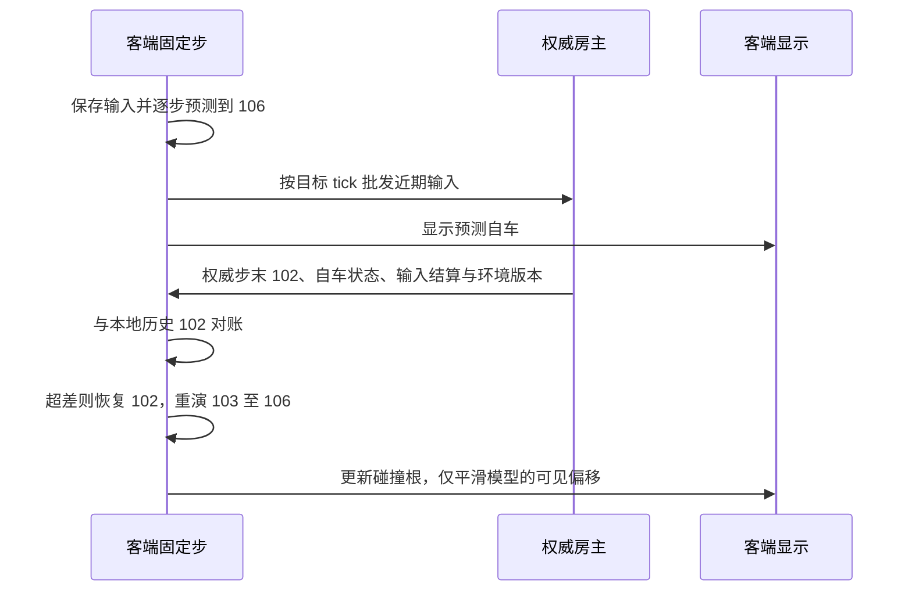

# physics-prediction · 同引擎房间的预测与验收

Windows x64 车场在每款引擎自己的房间里运行同一套 C++ 车辆模型。后续章节保留原生刚体、接触组和可选平滑策略的设计与实验条件。[实现决定](../decisions/physics-prediction.md) · [可复现实测](../../task/cross-engine-sync/验收/M6.md)

## 已实现的房主预测

- 客人在 30 Hz 固定步采集输入，按当前房间、对象和写权代次编号。通用 `Prediction<State, Input>` 保留最近的权威恢复点和最多 128 个待确认输入。每个发送周期先重传最早的最多 32 个未确认输入。房主按序每步最多结算一个输入，缺帧短暂延用上一输入，超过 8 步回中。[通用预测](../../core/state/prediction.hpp) · [样例模拟](../../../examples/yard/shared/match.cpp)
- 房主返回已完成的模拟步、输入确认序号、位置、朝向、油门、有符号车速和该步的碰撞环境。客人收到更新的检查点就恢复并重演剩余输入。门和路障另有携带生效步的可靠更新，迟到的环境更新也可触发重演。历史按步保存最近 160 份环境记录。输入窗满时停止向前预测，等房主确认释放空间。[检查点和场景事件](../../../examples/yard/shared/match_prediction.cpp)
- 代理使用房主采样步排序的 16 份快照，在约 100 ms 延迟处插值，缓冲耗尽时保持端点。显示时间单调递增。三个引擎直接采用已采样的显示姿态，本车可取预测或该客户端获权后的状态。离房重进时清空本地历史，恢复原对象、当下的速度和当前环境。[通用快照缓冲](../../core/state/snapshot_buffer.hpp)
- 本版使用相同 C++ 单步验证赛车。后面提到的按目标步提前输入、逐步状态误差阈值、原生物理世界和关节组属于这套车场模型的扩展设计。通用会话另有已验收的原生刚体组路径。[刚体组检查点](game-session.md#三维刚体组检查点)

## 扩展设计中的时间、权威与输入

| 量 | 含义与使用者 |
| --- | --- |
| `serverSimTick = T` | 房主已经完成 T 步。检查点是应用本步环境变化和输入、完成所有子步之后的状态。预测历史采用相同边界 |
| `targetTick`、`predictedTick` | 客人为每个目标服务器步生成一条输入，本地最新完成步称 predictedTick。输入按连接代次和目标步唯一。每步保存实际送入控制器的量化后输入 |
| `sendSeq`、`revision`、`sample_tick` | 发送批次序号用于传输诊断，对象版本用于差量确认，现有对象采样步是字段最后改变的物理步。同一批包可有多个采样步 |
| `closedThroughTick` | 某驾驶者截至该步的输入槽位已经执行或按缺失策略结算。仅在对应状态可用后裁剪重演历史。StateAck 继续只确认对象版本 |
| `renderTick` | 远车的播放时间，比估计房主步晚一个缓冲窗口；自车画面跟随本机预测时间 |

房主在基线和后续心跳中提供模拟步、固定步长及回显授时信息。客端用本地单调时钟及往返样本估计房主当前步，平滑调整速率，预测头单调前进。输入提前量覆盖预计上行、等到下一次 20 Hz 发送的时间与抖动，限定最大未来步数。丢失基准或房主长停顿时暂停前推并重取时间基准。在 30 Hz 下一个步约 33.3 ms，网络包间隔约 50 ms；采样与发包解耦，单包可以覆盖多个新步。测试用相同输入在 30/60/144 FPS 下比较。

1. 客端在固定步边界锁存模拟轴；按键边沿在渲染帧间累积，到对应步只消费一次。房主本机也走相同输入与固定步入口。脚本驾驶与实际按键产生同格式输入。
2. 游戏通道按步批量发送，建议起步携带最新步及此前 3 步的冗余。房主只从已 Ready 的有效连接定位驾驶者，验证范围、有限数、连续窗口和模式。收到未来步先缓存；相同目标步只接纳第一份有效输入。过迟、跨局及旧连接输入丢弃。固定宽度计数用有界窗口的环形比较，保留零值/换代规则。
3. 房主每步恰消费一个槽位。缺包时模拟轴短时沿用上一有效值，沿用上限初取当前规则的 8 步，然后回中；边沿缺失当作未按下。房主记录实际用的是原输入、保持还是回中，已结算步不再因迟包倒退。检查点确认结算进度，持续输入和一次性动作各自去重。开门、造拆等既有可靠业务动作归房主判定。

## 线上状态与恢复点

| 建议的记录 | 最小内容与投递 |
| --- | --- |
| 房间物理配置 | 在进入预测模式之前协商协议版本、步率/子步、维度、单位、运动模型与碰撞资产指纹、模板能力及后端。由房主选择有效模式。保留原配置与旧消息格式给 v1 房间；v2 房间在显式版本握手后启用新消息，旧客户端无法满足配置时在开局前拒绝 |
| 输入批次 | 现有房间、局次和有效连接身份，另带输入代次、目标步区间、量化轴与按钮。用尽力投递和最近步冗余。禁止客户端提交自己的最终位置作为权威结果 |
| 自车检查点 | 同一记录内原子携带 `objectId, epoch, serverSimTick, closedThroughTick, environmentRevision, motorState`。车场 motorState 至少含世界坐标 x/y、朝向、有符号速度。静止照常随发送节奏发小型检查点，从而裁剪输入。丢失中间包可用下一完整检查点恢复 |
| 刚体状态 | 2D 为位置、角度、线速度、标量角速度；3D 为位置、单位四元数、线速度、角速度向量。另有模式、睡眠/唤醒、传送代次。车辆控制器私有积分量、地面/运动平台引用、会变化的质量与约束参数等按模型列入完整恢复状态。固定材质、形状、质心、过滤层和重力配置由版本化模板约定 |
| 碰撞环境 | 房主赋予门的状态变化、运动平台姿态、障碍生成与销毁明确的生效步。同一步先应用有序环境变化，再积分车辆。基线记录环境版本与完整成员，之后带版本号、步号和稳定顺序的变更可检测缺口并补传。销毁的碰撞形状在历史窗内可供重演、本地节点按正常寿命释放 |

**与现有差量衔接。** 对象身份、生成、存活和销毁沿用现有复制。基础属性可继续走 float/flag schema；版本、步号和四元数采用有类型的物理记录，避免把整数身份挤入 float。预测模板明确哪一路写物理根，原 transform 字段如需兼容读取，派生自同一权威采样。对未知对象短暂缓存对应记录并设上限；已销毁、换局或旧代次的记录丢弃。基线进度需要同时覆盖对象与物理状态。重连时房主清空旧输入窗口，保留原车速度，在当前环境和本车基线就绪后再 Ready；Ready 重发的终止条件相应从 v1 的驾驶序号切换到 v2 的新代次握手/首个有效输入。

**采样一致性。** 现有逐对象差量可能跨包、跨 tick，只有每个 UDP 包自身原子。自车小检查点用完整记录先跑通；动态交互组需要同一 T 的成员列表、分片数和完整状态，收齐才提交整组，缺片时用下个完整检查点或请求基线。复用 1,176 字节游戏负载上限，编码前按实际长度分包。有预算优先发自车确认、交互组和唤醒/传送，再按活动度与距离发普通体；给冷对象留周期刷新和最终变更确认。记录实际字节/秒、超预算丢弃和等齐时长。[现有打包与确认](../../core/state/replication.cpp) · [传输上限](../../core/transport/transport.hpp)

**空间约定。** 新刚体配置建议用米、秒、弧度，3D 约定右手系、Y 向上、四元数顺序 xyzw，2D 约定 X 向右、Y 向上、逆时针为正。位置注明世界空间和刚体原点，线速度约定为质心速度。每个绑定声明单位比例和基变换，位移、普通向量、轴向量和姿态分别转换。跨手性时姿态可经基矩阵共轭转换，角速度作为轴向量处理。Unity 2D 角速度 API 用度每秒。车场已有的屏幕单位、顺时针角度及 Godot 的 `640 - y` 展示映射保留在旧模型绑定。建议先用有限 f32 和归一化四元数建立基线，再按场景范围量化位置/速度并压缩旋转；测端到端误差后设阈值。休眠、传送等离散字段精确比较。[车场坐标换算](../../../examples/yard/godot/yard/replicator.gd) · [Unity 2D 角速度](https://docs.unity3d.com/6000.4/Documentation/ScriptReference/Rigidbody2D-angularVelocity.html)

## 客端如何纠偏

- **保存什么。** 每步保留输入、步末预测状态、碰撞世界版本及可重建的环境变更、发生的游戏事件。历史长度须覆盖输入提前量、下行确认和抖动。例用 64 槽，30 Hz 时约 2.13 秒；内存按被预测对象或接触组分配。超过历史窗直接请求最新基线。已确认输入可停止重发；检查点与环境齐全后才回收对应历史。
- **何时重演。** 用 T 的预测值与 T 的权威值比较位置距离、最短角或四元数夹角、线/角速度和控制器私有量。误差阈值与编码精度和车型相配；离散状态或环境版本冲突须处理。完整匹配时前移确认。超差就恢复 T 步末，再按原始输入和当时环境推进 T+1 至预测头，每步覆盖旧历史。多份快照按可用且完整的最新 T 合并；过期快照不能撤销已确认进度。
- **缺历史怎么办。** 每一步依赖的门、路障和动态碰撞组必须可还原。若补到迟来的环境变化，从其生效步前最近可信检查点重演；收到更晚且齐全的权威检查点也可直接恢复。若权威 T 已超过本地预测头，从完整的 T 开始，为 T 之后的步采新输入。成员、环境版本、必需控制器状态或历史缺失导致无法衔接时先降为权威呈现、请求完整基线，成功后重新启用。预算可先试每渲染帧 4 个重演步；未完成的中间世界不对外发布，连续积压则降级，记录原因与耗时。
- **动态交互。** 双向施力的 A、B 即使只有 A 归本机控制，也要恢复同 tick 的 B、关节以及复演期间新接触的成员。被其他玩家驱动的 B 还需每步的控制、冲量或约定的近似输入，缺少未来输入产生的偏差由后续权威状态纠正。历史无法覆盖的边界用有轨迹的单向运动代理，或整组转权威。保存世界中的重力、子步数、睡眠和碰撞过滤，验证接触缓存无法恢复时的误差。碰撞查询使用模拟时间下的代理。
- **渲染与副作用。** 权威纠偏后物理根立即采用重演结果。显示根保存“上一可见位姿到新预测位姿”的误差并随时间衰减；权威传送、换局和重生清空误差。远车建议先试 2 个发送间隔即 100 ms 的缓冲，按抖动调整，基于 tick 线性插值位置、按最短路径插值角度，3D 用 slerp。缓冲耗尽时按模式有限外推（起步上限如 100 ms）或停住。物理重演期间不发 RPC、计分、生成或重复播放音效；即时本地特效可用 `(epoch, objectId, tick, eventId)` 去重，关键结果由权威确认。

## 客机写权的交接与续玩

上述输入确认和逐步对账适用于房主权威的对象。可委托的物体在房间配置中另声明允许客机写入的字段、模型和接管策略。一个对象的一组物理字段在同一模拟步至多有一个被房主认可的写入方。驾驶输入权限、业务归属和物理写权可以属于不同的角色。[客机状态权威设计](../decisions/physics-prediction.md#可选的客机状态权威)

| 场景 | 拟议行为与验收 |
| --- | --- |
| 授权及接管 | 房主在可靠控制通道发布对象、写入玩家、新代次、首个可写步 T 和交接基线。以已提交状态衔接 T 的步前状态，含速度、模型私有量和适用环境。旧权只覆盖 T 之前且尚未封闭的步。新方在授权与基线齐全后才能发布。在途状态包携带代次，迟到的授权、状态、回显均不能覆盖新代次。并发请求由房主选定唯一写入方 |
| 本车上行 | 获权客机以固定步模拟、按发送周期上传最近的完整运动样本。房主按玩家和可写字段检查，并记录来源模拟步与公开提交进度，其他客人播放已接纳的样本。持权方使用已接纳的来源步确认进度，静止时也可确认。普通回显不得把正在转向的自车拉回旧位姿。Ready 的确认同时支持客机状态上行 |
| 越权与拒绝 | B 可写车 B 的运动，写车 C、门状态、未来步、失效代次或超限位移均被拒绝。业务事件只由相应业务权威提交。来源位姿被拒时通知 B，用最近公开基线校正；连续失联或无法恢复时房主按策略收权 |
| 掉线与交还 | B 断线即失去旧代次。房主从最近接纳的原车完整状态接管，驾驶输入回中并按车场模型继续惯性与碰撞。B 恢复身份后先应用当前基线，再获得新代次。客机获得对象写权的房间仍遵循既有房主离房即结束的规则 |
| 最小三端实验 | A 开房，B 驾车，C 旁观。禁用房主对 B 车的车辆积分并暂扣 B 的驾驶输入，仅放行获授权状态包，A 和 C 仍应收到 B 的转向。断线接管后投递旧 B 状态，检查原车只由 A 推进；恢复后由新代次 B 推进。轮换 Unity、Godot、Cocos2d-x 扮演 B，并分别检验物理根与显示根 |

## 可执行的验收顺序

以下是新功能的验收目标。已有测试可先复现基线；增加延迟、限制重演预算和比较物理根需要相应探针。使用房主步与输入标记关联各端日志，用同端单调时钟量输入到画面的延迟。

| 用例 | 输入与故障 | 通过条件 |
| --- | --- | --- |
| 输入响应与权威确认 | 在静止空地按油门，暂扣所有下行 150 ms。切换转向；一轮保留所有包，一轮丢掉含中间输入的首包 | 下行返回前，自车在下一本地固定步移动并于下一次渲染可见。冗余窗口内丢包能恢复原步输入；晚于截止的输入按缺失规则结算。观察者只看到房主确认后的运动 |
| 可重复的恢复 | 在 T 人为扰动自车的位置或仅扰动车速，保留相同后续输入。另测停车时对象版本恒定、输入进度前移 | 对比的是 T；重演次数等于追到预测头所需的步数。共用模型与同输入、同环境的无扰动参考逐步比较，初始 f32 同构建目标可取位置 0.001 车场单位、方向 0.01°。静止时历史占用有界 |
| 路障与关节 | T 关门，T+1 撞门，T+2 开门或拆障碍，故意让变更包晚到；原生模式再试两车碰撞、推箱和关节链 | 轨迹与实际门状态一致；缺环境触发补传或重新基线。刚体组要么同 tick 恢复，要么报告明确降级；确认碰撞事件只产生一次 |
| 平台读回 | 每个平台分别测 2D 和 3D 的固定平移、绕单轴/组合轴旋转、角速度、休眠唤醒、传送、换父节点与节点替换。手动后端补 4 步 | 读实际物理根、速度及可视根，并记录采样阶段。正反坐标换算可逆，传送即时到位，休眠不漂移。物理 world 计数与固定子步数相符，未参与世界不随重演推进。未提供原生能力的组合须验证回退路径 |
| 生命周期与兼容 | 断线期间房主移动原车并造拆路障，恢复后投旧代次输入、再开新局；协商不同后端或 v1 客人 | 玩家与车辆身份符合既有规格，客户端从当前车速和环境重新预测，旧输入、旧事件和已删除物体不复活。能力选择和协议版本可从双端日志核对 |
| 抖动与负载 | 分别在 Unity、Godot、Cocos2d-x 的同引擎房间轮换房主与客人。4 人 100 对象，记录活跃/预测数。分档试 RTT 0/80/150/250 ms、单程抖动 0/20 ms、丢包 0/5%、突发断包、乱序、重复和渲染掉帧 | 输出预测误差和显示跳变 p50/p95/max、校正频率、重演步数、物理 CPU p95、每秒字节、历史占用及回退数。每相同输入最多执行一次权威动作；补演遵守预算，超窗能恢复。原生求解器对比使用定义的误差和玩法结果，跨后端采用权威检查点收敛 |

在框架仓根目录运行 `python -B tools/build.py core --config Debug` 构建并执行 Core 测试。在同级示例仓根目录运行 `python -B tools/build.py` 构建并执行车场 `match`、`prediction` 测试。构建对应引擎的车场后，运行 `python -B tools/verify_yard.py play --platform unity --fault` 复现故障场景，`--platform` 也可选 `godot` 或 `cocos2dx`。每场保存房主与客人的日志，并核对最终状态摘要。[双端脚本](../../../examples/tools/verify_yard.py) · [匹配与恢复测试](../../../examples/tests/match_test.cpp) · [预测测试](../../../examples/tests/prediction_test.cpp)
