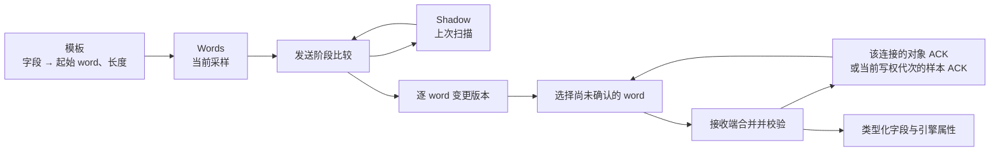

# property-binding · 同引擎属性同步

## 状态布局和差量

模板注册时按字段顺序生成 word 偏移。标量占一个 32 位 word，向量按分量排列，64 位引用先低后高。浮点保留 IEEE 754 位模式。变长字段首 word 存当前长度，后续按声明容量预留固定位置。字符串和字节数组每四字节共用一个 word，尾部补零。集合缩短时清零废弃位置。字符串采用内联定长槽，Fusion Core v3 的字符串堆属于另一种布局。[本项目类型映射](../../core/state/value.cpp) · [Fusion Words 与 Shadow](https://doc.photonengine.com/fusion-core/v3/manual/objects#shadow-buffer) · [Fusion String Heap](https://doc.photonengine.com/fusion-core/v3/manual/string-heap)

```text
模板       Vec2           Flag       Bytes(capacity=7)
偏移         0       1       2          3        4          5
Words     [ X bits | Y bits | 0/1 | byte_count | byte 0–3 | byte 4–6 + 0 ]
Shadow    [ 同一布局，保存上次发送扫描看到的位模式                      ]
Versions  [ v0     | v1     | v2  | v3         | v4       | v5           ]
```



房主用对象版本记录 word 变化，客机持写权时用授权内的样本序号。扫描和确认独立。若同一 word 在两次扫描间变回原值，该轮无需为它新增变更记录。若发送过的状态尚未确认，即使 `Words` 与 `Shadow` 已相同，变化仍可随最新状态重发。用逐客人保存的已确认快照也能实现收敛，但会增加随连接数增长的副本。双客人测试分别确认到不同版本，以验证共用一份 `Shadow` 时仍能独立补发。[复制回归](../../tests/core/replication_test.cpp) · [写权回归](../../tests/core/game_session_test.cpp)

会话用 `WordStateHello` 和 `WordStateSupported` 协商差量。稀疏记录用 varint 写数量和相对位置，再用 ZigZag varint 写 word 位模式。完整基线、旧 SDK、量化配置及更紧凑的字段编码走字段格式。接收端用模板检查范围、类型和集合尾部，再原子提交快照或写权样本。引擎接口仍消费类型化值。[房主复制](../../core/state/replication.cpp) · [客机上行](../../core/session/object_authority.cpp)

通用会话和车场直连对每条连接分别协商。房主先发送字段格式，收到本局的 `WordStateHello` 后才启用下行 word 差量，客机收到 `WordStateSupported` 后才启用持权上行 word 差量。探测在丢包后重试，换局重新协商。若连接切换量化模式，房主以新版本重发受影响且可见的完整基线。该基线仍按连接确认，迟到的旧投影无法覆盖它。[协商与写权](../../core/session/object_authority.cpp) · [量化切换](../../core/state/replication.cpp)

房主发送 `AuthorityGrant` 时，为该接收方登记授权引用的对象版本。若该版本尚未确认，房主用完整字段刷新并按连接重试。即使两次采样间的值变回原样，或者观察者较晚完成模型协商，公开副本仍能追到授权引用的版本。场景和依赖的可见性条件照常生效。[授权投递](../../core/session/object_authority.cpp) · [基线选择](../../core/state/replication.cpp)

## 首轮行为规格

**状态：项目首轮验收目标。** 一个对象、开房并决定最终状态的 A、同引擎接收端 B，以及一个浮点字段 `net_input_x`。先使用可控时钟和内存链路，再在 Windows x64 两个 Cocos2d-x 进程加载声明式配置验证。

| 阶段 | 输入或操作 | 自研首轮验收 |
| --- | --- | --- |
| 初始状态 | 双端加载相同对象和字段定义，初值为 0 | B 可以建立该对象的初始状态 |
| 赋值 | A 把字段写为 0.75，暂缓采集与投递 | A 可以读到 0.75，B 保持此前状态 |
| 采集 | 显式推进一次 A 的采集 | A 得到可编码的当前值。此时可以更改现场值以检验该轮采集是否持有独立状态 |
| 投递与应用 | 只投递上述已采集状态，在 B 推进一次直接应用 | B 的字段为 0.75；示例值可精确表示，其他取值的量化精度另行定义 |
| 第二次更新 | A 改为 -0.5，再采集、投递、应用 | B 收敛为 -0.5，重复场景可得到相同结果 |

上述步骤覆盖房主计算之后的属性复制。完整联机验收另需覆盖输入上行：客人 B 发油门输入，房主 A 的游戏逻辑计算车辆状态，再由复制层向 B 提交最终属性。测试应分别记录输入抵达、房主写值以及客人应用三个观察点。[房间与游戏通道决定](../decisions/game-transport.md)

首轮允许手动推进，并分别记录对象、字段、阶段和本地序号。Godot 绑定可以使用 `.:net_input_x`，Cocos 可以使用显式 getter/setter；两端共同约定稳定的字段身份、类型和单位。[适配器边界决定](../decisions/engine-boundary.md)

**首版接入验收**：用可配置的 Replicator 启用常见变换预设，并显式选择根节点和子节点上的自定义属性。开局前 A、B 均已入房；在预置网络节点上分别改动两个字段，核对 B 读回的值。再由 A 生成一个已注册模板的实例，验证 B 建立对应实例并应用属性，A 销毁后 B 移除该实例。开局后新玩家的加入请求按房间规则拒绝。

**变换与显示**：覆盖 2D 和 3D 的位置、旋转和缩放。房主游戏逻辑推进物理与权威状态。测试分别记录收到的快照值和插值后的显示位置，并验证连续两个快照之间的可见移动。普通浮点字段采用表中直接应用场景。旋转与缩放的编码精度、表现平滑策略待定。首版本地预测留待后续。

**尚待原版回答**：一次有效采集前多次赋值时，B 实际观察到哪些中间值？权威端哪些条件会影响 getter 次数？对应证据见[原版记录](../../research/fusion/findings/property-binding.md)。首轮自研测试的显式时钟只用于验证可分离的阶段。
