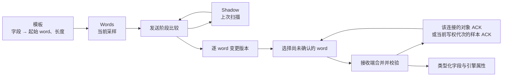

# property-binding · 同引擎属性同步

Godot 的场景组件可从节点属性直接生成下述字段模板。[Godot 属性选择、容量和写权](godot-scene-sync.md#声明属性)


## 配置与字段值

`ReplicationLayout` 以稳定字段号标识值。两端使用相同模板版本和字段布局，注册时检查单对象按声明容量计算的最大包长。现行编码共 16 类，原有九类保留编号。[字段编码](../../core/state/value.cpp) · [配置解析](../../core/state/layout.cpp)

| 字段 | 模板写法 | 约定 |
|---|---|---|
| 标量 | `float`、`flag`、`int` | 有限单精度数、布尔值、有符号 32 位整数 |
| 向量、旋转与颜色 | `vec2`、`vec3`、`vec4`、`quat`、`color` | 四维向量、单位四元数和 RGBA 颜色各有独立类型 |
| 对象引用 | `object_ref` | 本回合的 64 位引用，零表示空。目标可见且已绑定时可解析为本地场景对象 |
| 文本与二进制 | `string`、`bytes` | 声明字节数上限，字符串使用 UTF-8 |
| 数组和列表 | `int_array`、`float_array`、`vec2_array`、`int_list` | 声明元素数上限，有序整数列表保留顺序和重复值 |
| 整数映射 | `int_map` | 声明条目数上限，键和值均为有符号 32 位整数，编码按键排序 |

变长值可以为空。各引擎的挂载组件可以自动采集属性，也可以将状态应用到实际刚体。控制台示例还检查客端引用解析出的对象是否就是场景中的二维刚体。[示例模板](../../../examples/puzzle/components.cfg) · [组件与引用生命周期](game-session.md#玩法字段命名调用与挂载组件) · [双端验收](../../task/gameplay-components/验收/本机.md)

## 字段声明与本地成员

一份模板含 1–64 个字段，字段号必须为非零且严格递增。同一引擎的房主和客人使用相同的模板号、版本、字段号、类型和容量。框架分别提供 Godot、Unity 和 Cocos2d-x SDK。增加字段或改变容量时应同步两端配置。[模板校验](../../core/state/replication.cpp)

| 需要区分的类型 | Godot | Unity | Cocos2d-x |
|---|---|---|---|
| 房内对象引用 | 兼容脚本导出器用 `int` 保存句柄并以 `reference_fields` 标记字段号；原生节点的对象引用绑定见[场景接入](godot-scene-sync.md) | `ulong` | `netcode::ObjectReference` |
| 整数数组、有序整数列表 | `PackedInt32Array`、`Array[int]` | `int[]`、`LinkedList<int>` | `IntArray`、`IntLinkedList` |
| 整数表 | `Dictionary[int,int]` | `Dictionary<int,int>` | `IntMap` |
| 二进制、二维向量数组 | `PackedByteArray`、`PackedVector2Array` | `byte[]`、`Vector2[]` | `Bytes`、`Vector2Array` |

在 Unity 中绑定根或后代组件的公开实例成员：字段须可写，属性须有公开 getter、setter 且不带索引。Godot 的属性路径相对于复制根节点，按模板顺序排列。Cocos2d-x 按相同顺序注册成员或访问器。对象引用保存的是本回合的句柄，使用时再解析到本地节点。[Godot 导出器](../../engineplatform/godot/layout_exporter.gd) · [Unity 挂载组件](../../engineplatform/unity/managed/NetcodeReplica.cs) · [C++ 类型表](../../core/state/value.hpp)

## 状态布局和差量

模板注册时按字段顺序生成 word 偏移。标量占一个 32 位 word，向量按分量排列，64 位引用先低后高。浮点保留 IEEE 754 位模式。变长字段首 word 存当前长度，后续按声明容量预留固定位置。字符串和字节数组每四字节共用一个 word，尾部补零。集合缩短时清零废弃位置。字符串采用内联定长槽，Fusion Core v3 的字符串堆属于另一种布局。[本项目类型映射](../../core/state/value.cpp) · [Fusion Words 与 Shadow](https://doc.photonengine.com/fusion-core/v3/manual/objects#shadow-buffer) · [Fusion String Heap](https://doc.photonengine.com/fusion-core/v3/manual/string-heap)

```text
模板       Vec2           Flag       Bytes(capacity=7)
偏移         0       1       2          3        4          5
Words     [ X bits | Y bits | 0/1 | byte_count | byte 0–3 | byte 4–6 + 0 ]
Shadow    [ 同一布局，保存上次发送扫描看到的位模式                      ]
Versions  [ v0     | v1     | v2  | v3         | v4       | v5           ]
```



房主用对象版本记录 word 变化，客机持写权时用授权内的样本序号。扫描和确认独立。若同一 word 在两次扫描间变回原值，该轮无需为它新增变更记录。若发送过的状态尚未确认，即使 `Words` 与 `Shadow` 已相同，变化仍可随最新状态重发。用逐客人保存的已确认快照也能实现收敛，但会增加随连接数增长的副本。双客人测试分别确认到不同版本，以验证共用一份 `Shadow` 时仍能独立补发。[复制回归](../../tests/core/replication_test.cpp) · [写权回归](../../tests/core/game_session_test.cpp)

会话用 `WordStateHello` 和 `WordStateSupported` 协商差量。稀疏记录用 varint 写数量和相对位置，再用 ZigZag varint 写 word 位模式。完整基线、旧 SDK、量化配置及更紧凑的字段编码走字段格式。接收端用模板检查范围、类型和集合尾部，再原子提交快照或写权样本。引擎接口仍消费类型化值。[房主复制](../../core/state/replication.cpp) · [客机上行](../../core/session/object_authority.cpp)

通用会话和车场直连对每条连接分别协商。房主先发送字段格式，收到本局的 `WordStateHello` 后才启用下行 word 差量，客机收到 `WordStateSupported` 后才启用持权上行 word 差量。探测在丢包后重试，换局重新协商。同一会话中的旧 SDK 可继续走字段格式。Godot 原生房间还要求双方通过原生协议与模板目录握手。若连接切换量化模式，房主以新版本重发受影响且可见的完整基线。该基线仍按连接确认，迟到的旧投影无法覆盖它。[协商与写权](../../core/session/object_authority.cpp) · [Godot 原生兼容边界](godot-scene-sync.md#原生节点接入) · [量化切换](../../core/state/replication.cpp)

## 首轮行为规格

**状态：项目首轮验收目标。** 一个对象、开房并决定最终状态的 A、同引擎接收端 B，以及一个浮点字段 `net_input_x`。先使用可控时钟和内存链路，再在 Windows x64 两个 Cocos2d-x 进程加载声明式配置验证。

| 阶段 | 输入或操作 | 自研首轮验收 |
| --- | --- | --- |
| 初始状态 | 双端加载相同对象和字段定义，初值为 0 | B 可以建立该对象的初始状态 |
| 赋值 | A 把字段写为 0.75，暂缓采集与投递 | A 可以读到 0.75，B 保持此前状态 |
| 采集 | 显式推进一次 A 的采集 | A 得到可编码的当前值。此时可以更改现场值以检验该轮采集是否持有独立状态 |
| 投递与应用 | 只投递上述已采集状态，在 B 推进一次直接应用 | B 的字段为 0.75；示例值可精确表示，其他取值的量化精度另行定义 |
| 第二次更新 | A 改为 -0.5，再采集、投递、应用 | B 收敛为 -0.5，重复场景可得到相同结果 |

上述步骤覆盖房主计算之后的属性复制。完整联机验收另需覆盖输入上行：客人 B 发油门输入，房主 A 的游戏逻辑计算车辆状态，再由复制层向 B 提交最终属性。测试应分别记录输入抵达、房主写值以及客人应用三个观察点。[房间与游戏通道决定](../decisions/game-transport.md)

首轮允许手动推进，并分别记录对象、字段、阶段和本地序号。Godot 房间可用 `.:net_input_x` 绑定两端属性，Cocos 房间可用显式 getter/setter。同一房间的两端约定稳定的字段身份、类型和单位。[适配器边界决定](../decisions/engine-boundary.md)

**首版接入验收**：用可配置的 Replicator 启用常见变换预设，并显式选择根节点和子节点上的自定义属性。开局前 A、B 均已入房；在预置网络节点上分别改动两个字段，核对 B 读回的值。再由 A 生成一个已注册模板的实例，验证 B 建立对应实例并应用属性，A 销毁后 B 移除该实例。开局后新玩家的加入请求按房间规则拒绝。

**变换与显示**：覆盖 2D 和 3D 的位置、旋转和缩放。房主游戏逻辑推进物理与权威状态。测试分别记录收到的快照值和插值后的显示位置，并验证连续两个快照之间的可见移动。普通浮点字段采用表中直接应用场景。旋转、缩放精度与平滑策略按玩法验收。车场后来实现了本车固定步预测和远车快照插值。[已实现的房主预测](physics-prediction.md#已实现的房主预测)

原版 Preview 555 的 Shared 双端实验中，权威端在同一脚本回调依次写入 `0.125、0.375、0.875`，代理 setter 只执行一次，收到约 `0.88`。60 与 30 Hz 的稳定物理驱动下，权威端 60 个物理步均读字段 60 次，关闭该字段后为零。自研首轮用显式时钟验收采集、投递、应用三个阶段，自研 f32 按自身编码精度核对。[原版条件与数值](../../research/fusion/findings/client-audit.md)
