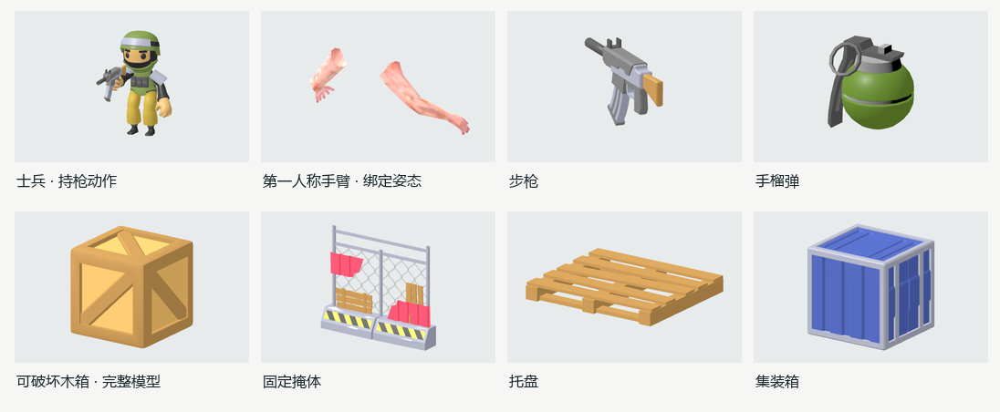

# FPS 资产清单与制作计划

## 整体美术风格（已确认）

全项目统一采用**卡通 low-poly（低多边形）**。角色比例与服装以已入库的卡通士兵为参照。仓库、楼梯、武器、掩体和可拾取物沿用简洁的几何轮廓、清晰的色块和材质分区。第一人称手臂保留现有骨架，制作时统一手部材质、袖口和队色。枪口闪光、曳光与爆炸也采用简洁的卡通形状。

验收时，在同一仓库位置分别截取本机持枪画面和队友观察画面，对照两种视角中的手臂、服装与步枪。关闭 HUD 后，仍应能从外观分辨队伍、补给、可破坏木箱和固定掩体。

## 当前资产进度

8 个原始模型已通过 Godot 4.7.1 导入。仓库已接入原始士兵骨骼和第一人称手臂。Blender 制作了可动弹匣、补给包、碎木板和墙板，游戏直接加载导出的 GLB。双手解算、动作时间线、队色、楼梯和梯子的最终装配在 Godot 源码中。[模型来源与哈希](../../../examples/shiftline/assets/sources.json) · [Blender 源文件](../../../examples/shiftline/assets/source/shiftline-kit.blend) · [原始资产导入](验收/资产样件.md)

## 已取得的模型

| 资产文件 | 首版用途 | 接入时的工作 |
|---|---|---|
| [Character_Soldier.gltf](../../../examples/shiftline/assets/quaternius/Character_Soldier.gltf) | 远端及其他玩家看到的全身角色，43 根骨骼、17 段动作 | 同一骨架复用两套服装队色。模型内有多件武器子网格，角色场景只显示当前武器；按双手持枪姿势校准左手。 |
| [arms.glb](../../../examples/shiftline/assets/wrad-arms/arms.glb) | 本地相机前的双臂，50 根骨骼 | 原素材为复古写实皮肤，现有动作数为 0。用 Blender 补短袖、手套与简化材质，使其与远端士兵一致。保留手腕和手指权重。 |
| [AK.gltf](../../../examples/shiftline/assets/quaternius/AK.gltf) | 第一人称手持步枪、远端同款武器 | 同一外观用于两个视角。原独立模型是一个静态网格，在 Blender 分离可动弹匣，记录左右手挂点及游戏特效挂点。 |
| [Grenade.gltf](../../../examples/shiftline/assets/quaternius/Grenade.gltf) | 手持、离手飞行、地面补给 | 三种场景复用同一个外观。到投掷动作的离手帧时切换手中模型与世界模型；补给加底座和图标。 |
| [Crate.gltf](../../../examples/shiftline/assets/quaternius/Crate.gltf) | 挡住通路的可破坏木箱 | 已有完整外观，Blender 从同一网格制作破碎版。碎片只做短时本地表现，破箱后能实际走过。 |
| [Barrier_Fixed.gltf](../../../examples/shiftline/assets/quaternius/Barrier_Fixed.gltf) | 固定围挡和路线边界 | 按立柱、底座和板件设简化碰撞；网片与实心掩体在画面上要能区分。 |
| [Pallet.gltf](../../../examples/shiftline/assets/quaternius/Pallet.gltf) | 装卸区托盘、货堆和补给摆位 | 共用材质，按能否踩上设置碰撞，避免底部间隙卡住人物。 |
| [Container_Small.gltf](../../../examples/shiftline/assets/quaternius/Container_Small.gltf) | 仓库内外的实心固定掩体 | 与木箱用明显不同的材质和轮廓；用角色、步枪射线和投掷物检查碰撞边界。 |

士兵、武器和仓库道具等 7 件来自 Quaternius 的 Toon Shooter Game Kit，手臂来自 wwwriks 的 WRAD ARMS。两位作者均以 CC0 发布，免费且无需署名。项目保存了来源、原始文件哈希及许可文本，发布说明保留作者名。[Quaternius 官方包](https://quaternius.com/packs/toonshootergamekit.html) · [角色发布页](https://poly.pizza/m/PpLF4rt4ah) · [WRAD ARMS 作者仓库](https://github.com/wwwriks/wrad-arms) · [CC0 许可](../../../examples/shiftline/assets/licenses/CC0-1.0.txt)

## 动作逐项安排

| 游戏动作 | 本机第一人称 | 其他人看到的全身角色 |
|---|---|---|
| 持枪待机、走、跑 | Blender 制作双手握枪基准姿势，轻微移动随角色速度叠加 | 已有 Idle、Walk、Run、Run_Gun。校正双手握持、两队共用动画。 |
| 蹲伏、上下梯 | 相机随角色高度变化，梯上收枪，离梯恢复 | 已有 Duck，先验证在蹲伏期间可保持。Blender 补循环爬梯，上下方向由播放方向或独立片段驱动。 |
| 开火 | Blender 制作可循环的射击动作，校验连发时衔接 | 已有 Idle_Shoot、Walk_Shoot、Run_Shoot，按运动状态播放。 |
| 换弹 | Blender 制作取下、替换、归位的连续动作；在近镜头下检查弹匣和两只手 | 源文件 17 段中没有换弹。用同一武器挂点制作全身上半身动作，可与移动混合。 |
| 投掷 | Blender 制作取出、投出、回到步枪姿势，标记离手帧 | 源文件没有投掷，制作远端能辨认的抬臂、离手和收势动作。 |
| 阵亡、复活 | 阵亡收起手臂，复活恢复持枪基准姿势 | 已有 Death，复活时退出死亡状态，重置道具挂点与动作。 |

两个视角使用各自骨架和动画片段，同一次玩法动作使用同一标识。枪口闪光、弹匣显隐和手榴弹离手跟随表现事件；扣弹、伤害与投掷物生成沿用房主规则。T4 用两个可见窗口逐动作对照。

## 需要自制的场景与道具

| 制作项 | 工具和交付物 | 验收方式 |
|---|---|---|
| 双层仓库 | Godot 灰盒先定人物尺度、门洞和路线。Blender 制作可拼接的地面、墙、门框、楼板、侧房、楼梯、直梯、平台和护栏；在 Godot 拼成一张原创地图。托盘、木箱、围挡和集装箱沿用已入库模型。 | 从两个出生区分别走通地面和二层；可上下梯、通过侧房、在掩体后遮挡视线。角色脚下、头顶和梯顶碰撞与画面相符。 |
| 弹药包、手榴弹补给、碎箱 | Blender 制作一件弹药包、可区分的补给底座、一套木箱碎片；在 Godot 组装可见／已拾取／已破坏状态。 | 隐藏文字后仍能区分两种补给和可破坏木箱。第三人中途加入，看见当前外观且能穿过已打通的路。 |
| 子弹与爆炸表现 | 步枪按已确认的射线判定，用 Godot 短时网格或粒子制作曳光、枪口闪光和命中反馈；手榴弹有独立飞行模型和爆炸粒子。 | 射手有命中反馈，旁观者能看见曳光和投掷轨迹；同一次动作可见一次对应效果。 |
| 手臂与队服材质 | Blender 保存手臂、动作与武器的可编辑源，导出 GLB；队服在 Godot 对指定服装材质做实例覆盖。 | 第一人称双手不穿枪、不穿近裁面；两个视角的袖口和步枪外观一致；两个阵营同屏能辨色。 |

## 制作顺序

1. **[已完成] 取得并导入样件。** 8 份原始模型入库并校验哈希，在空白 Godot 工程逐件实例化、核对骨架与动作，并生成上图。
2. **[已实现] 双视角换弹。** 两端使用同一拆分后的步枪和弹匣。第一人称手臂用腕部目标和肘部提示解算；远端在全身动画之上附加换弹手臂动作。
3. **[已实现] 地图与道具。** Blender 提供墙面与道具模型。仓库平面、楼梯、直梯、护栏、碰撞和材质分区由 `arena/warehouse.gd` 装配。
4. **[双端通过] 其余动作。** 第三人称复用持枪跑动、射击和阵亡片段，程序驱动上半身爬梯、换弹与投掷。第一人称按动作推进腕部、枪体和弹匣。[双端可视测试](验收/G4.md)
